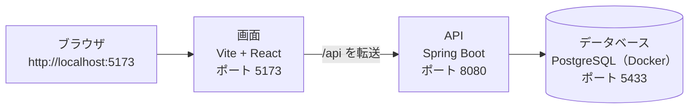

# タスクボード

Trello のように、タスクをカードにして「やること」「進行中」「完了」の3列で管理する Web アプリです。カードは追加・削除・ドラッグで動かせ、並びはデータベースに保存されるので、ページを開き直しても残ります。

## 目次

- [できること](#できること)
- [技術スタック](#技術スタック)
- [しくみ](#しくみ)
- [はじめかた](#はじめかた)
- [テスト・型チェック・ビルド](#テスト型チェックビルド)
- [API](#api)
- [フォルダ構成](#フォルダ構成)
- [ドキュメント](#ドキュメント)
- [困ったとき](#困ったとき)
- [開発の進め方](#開発の進め方)

## できること

ボードは1枚で、ログインはありません。このサーバーを開くブラウザは、みな同じボードを見ます。

| 列 | 意味 |
| --- | --- |
| **やること** | まだ手を付けていないタスク |
| **進行中** | 今やっているタスク |
| **完了** | 終わったタスク |

### カードの操作

- 「やること」にカードを追加する。期限の日付も入れられる（空でもよい）
- カードの日付をあとから変える
- カードを削除する（確認なし）
- 「進行中へ」「完了へ」などのボタンで、別の列の末尾へ移す
- カードをドラッグして、別の列や同じ列の好きな位置へ移す（マウスでもタッチでも動く）
- 操作するたびに自動で保存され、ページを開き直しても最後の並びが残る

### 検索

- 画面上部の検索フォームで、キーワード・状態・優先度・期限の範囲からタスクを探す。結果は3列のボードに出る
- 検索中も、ボタンやドラッグで列を移せる。移した結果は保存され、検索結果にもすぐ反映される
- 削除・追加・日付の変更は、検索を解除してから行う
- 「解除」で、いつものボードに戻る

## 技術スタック

| 層 | 役割 | 技術 | バージョン |
| --- | --- | --- | --- |
| フロントエンド | 言語 | TypeScript | 7.0.2 |
| フロントエンド | UI ライブラリ | React | 19.3.1 |
| フロントエンド | ビルドツール・開発サーバー | Vite | 8.3.6 |
| フロントエンド | 実行環境 | Node.js | 24.20.0 |
| フロントエンド | パッケージ管理 | npm | 11.19.0 |
| バックエンド | 言語 | Java | 21 |
| バックエンド | フレームワーク | Spring Boot | 4.1.2 |
| バックエンド | ビルドツール | Gradle | 8.14.3 |
| データベース | DBMS | PostgreSQL（Docker） | 17.11 |
| 開発環境 | コンテナ | Docker | 29.9.2 |

ライブラリごとの細かいバージョン（Hibernate、Jackson、JUnit など）は [docs/tech-stack.md](docs/tech-stack.md) にまとめています。

## しくみ



1. ブラウザは画面（5173）を開く
2. 画面が `/api/...` を呼ぶと、Vite がそれを API（8080）へ転送する（`frontend/vite.config.ts` の proxy）
3. API はデータベース（5433）を読み書きして、JSON で返す

ページを開いたときは `GET /api/tasks` で全カードを読みます。カードの追加は `POST /api/tasks` で1件ずつ登録し、削除・移動・日付の変更の直後は `PUT /api/tasks` で3列ぶんをまとめて保存します。書き込みは1つずつ順番に送るので、追加と移動が重なってもカードが二重になったり消えたりしません。

## はじめかた

### 必要なもの

| ツール | 用途 |
| --- | --- |
| [Docker Desktop](https://www.docker.com/products/docker-desktop/) | PostgreSQL を動かす |
| Java 21（JDK） | バックエンドを動かす |
| [Node.js](https://nodejs.org/)（npm 付き） | フロントエンドを動かす |

Gradle は `gradlew.bat`（Gradle Wrapper）が自動で用意するので、別に入れる必要はありません。

### 1. 最初の1回だけ：フロントエンドの部品を入れる

```
cd frontend
npm install
```

### 2. まとめて起動する（おすすめ）

`TaskManagement` フォルダで次を実行すると、DB・API・画面を順に起動します。

```
powershell -ExecutionPolicy Bypass -File scripts\start-servers.ps1
```

- 使うポートは下の表で決まっています。ポートが使用中なら、そのプロセスを止めてから同じポートで起動します
- 起動のログは `logs/` に日時付きで残ります

起動できたら、ブラウザで http://localhost:5173 を開きます。

### ポート（変えないこと）

| 役割 | ポート | 個別に起動するとき |
| --- | --- | --- |
| DB（PostgreSQL / Docker） | 5433 | `docker compose up -d` |
| API（Spring Boot） | 8080 | `cd backend` → `gradlew.bat bootRun` |
| 画面（Vite + React） | 5173 | `cd frontend` → `npm run dev` |

ポートを変えると、アプリが動かなくなります。

- 画面の `/api` は 8080 へ転送する設定になっている（`frontend/vite.config.ts`）
- API は 5173 からのアクセスだけを許可している（CORS、`backend/src/main/java/com/taskmanagement/config/WebConfig.java`）
- Vite は `strictPort: true` なので、5173 が使用中だと別のポートにずれず、エラーで止まる

### データベースの接続情報

| 項目 | 値 |
| --- | --- |
| ホスト / ポート | `localhost:5433` |
| データベース名 | `taskboard` |
| ユーザー | `taskboard` |
| パスワード | `taskboard` |

**開発環境専用の値です。** 本番環境では、推測されにくいパスワードを使い、設定ファイルに直接書かずに環境変数などで渡してください。設定は `docker-compose.yml` と `backend/src/main/resources/application.yml` にあります。

### 初期データとテストデータ

- `tasks` テーブルが空のまま API を起動すると、`backend/src/main/resources/data.sql` が各列2件ずつ、計6件のカードを入れます
- 検索を試すためのテストデータは `backend/db/test-data.sql` にあります。何回流しても同じタイトルは二重に入りません。`TaskManagement` フォルダで次を実行します

```
docker compose exec -T db psql -U taskboard -d taskboard < backend/db/test-data.sql
```

## テスト・型チェック・ビルド

| やること | 場所 | コマンド |
| --- | --- | --- |
| バックエンドのテスト | `backend` | `gradlew.bat test` |
| フロントエンドの型チェック | `frontend` | `npm run typecheck` |
| フロントエンドのビルド（型チェック込み） | `frontend` | `npm run build` |

バックエンドのテストは、データベースを使わずに動きます（Controller は `@WebMvcTest`、Service は Mockito）。ビルドの結果は `frontend/dist/` にできます（Git では管理しません）。

## API

すべて `http://localhost:8080/api/tasks` の下にあります。

| メソッド | パス | 内容 |
| --- | --- | --- |
| GET | `/api/tasks` | 全件を、列と並びの順で返す |
| GET | `/api/tasks/{id}` | 1件を返す。無ければ 404 |
| GET | `/api/tasks/status/{status}` | その列のカードを返す。`status` は `todo` / `in_progress` / `done`。それ以外は 400 |
| GET | `/api/tasks/search` | 条件に合うタスクを返す（下の表） |
| POST | `/api/tasks` | タスクを1件登録する。必須は `title` だけ。「やること」の末尾に入り、201 を返す。値が正しくないときは 400 |
| PUT | `/api/tasks` | 画面の3列ぶんの配列で、タスクをまとめて置き換える。配列に無いカードは削除される |

`GET /api/tasks/search` の条件は、どれも省略できます。指定したものをすべて満たすタスクだけを返します。

| パラメータ | 意味 | 例 |
| --- | --- | --- |
| `keyword` | タイトルか説明に含む文字（部分一致、大文字小文字を区別しない） | `keyword=メール` |
| `status` | 状態：`todo` / `in_progress` / `done` | `status=todo` |
| `priority` | 優先度：`high` / `medium` / `low` | `priority=high` |
| `dueFrom` / `dueTo` | 期限の範囲（`YYYY-MM-DD`、両端を含む。期限のないタスクは除かれる） | `dueFrom=2026-11-01&dueTo=2026-11-30` |

値が正しくないときや、`dueFrom` が `dueTo` より後のときは 400 を返します。

例：

```
curl "http://localhost:8080/api/tasks/search?keyword=メール&priority=high"
```

1件登録の例（Windows のコマンドで日本語を送ると文字コードがずれることがあるので、本体は UTF-8 のファイルに書いて送ると確実です）：

```
curl -X POST http://localhost:8080/api/tasks -H "Content-Type: application/json" --data-binary @task.json
```

JSON の形は [docs/functional-requirements.md](docs/functional-requirements.md) の「2. API」に書いています。

## フォルダ構成

```
TaskManagement/
├── README.md               … このファイル
├── docker-compose.yml      … PostgreSQL の起動設定
├── docs/                   … 設計書（要件、機能、画面、テーブル、技術）
├── scripts/
│   └── start-servers.ps1   … DB・API・画面をまとめて起動する
├── logs/                   … 起動のログ（Git では管理しない）
├── backend/                … API（Spring Boot）
│   ├── build.gradle.kts    … 使うライブラリとバージョン
│   ├── db/test-data.sql    … 検索を試すためのテストデータ
│   └── src/
│       ├── main/java/com/taskmanagement/
│       │   ├── config/      … CORS の設定
│       │   ├── controller/  … API の受け口（URL と JSON）
│       │   ├── service/     … 処理の中身（保存、検索、入力のチェック）
│       │   ├── repository/  … データベースの読み書き
│       │   └── entity/      … テーブルに対応するクラス
│       ├── main/resources/
│       │   ├── application.yml … DB の接続先とポート
│       │   └── data.sql     … 初期データ（6件）
│       └── test/            … テスト
├── frontend/               … 画面（React + TypeScript）
│   ├── package.json        … 使うパッケージとバージョン、npm のコマンド
│   ├── vite.config.ts      … ポートと /api の転送の設定
│   └── src/
│       ├── main.tsx         … 画面の入口
│       ├── App.tsx          … 画面全体。部品と hooks を組み合わせ、検索中の移動をまとめる
│       ├── App.css          … 見た目
│       ├── components/      … 画面の部品
│       │   ├── SearchForm.tsx  … 検索フォーム
│       │   ├── Board.tsx       … 3列を横に並べる
│       │   ├── Column.tsx      … 列1つ
│       │   ├── TaskCard.tsx    … カード1枚（日付、削除、移動）
│       │   └── AddCardForm.tsx … やることの追加欄
│       ├── hooks/           … 画面の状態と動き
│       │   ├── useBoard.ts     … ボードの読み込みと保存（書き込みは1つずつ順番に送る）
│       │   ├── useSearch.ts    … 検索の条件と結果
│       │   └── useCardDrag.ts  … カードのドラッグ
│       ├── api/taskApi.ts   … API の呼び出し
│       ├── lib/board.ts     … ボードを組み替える処理（React に依存しない）
│       └── types/task.ts    … 型
└── prototype/              … サーバーへ保存する前の静的な試作（HTML / CSS / JS）
```

## ドキュメント

設計書はすべて `docs/` にあります。同じ内容を2か所に書かず、それぞれの文書が自分の担当だけを書きます。

| ファイル | 内容 |
| --- | --- |
| [docs/requirements.md](docs/requirements.md) | 要件定義。目的、利用者、データの流れ、非機能要件、技術選定、対象外 |
| [docs/functional-requirements.md](docs/functional-requirements.md) | 機能要件の一覧（F-01〜F-18）と、API の仕様と JSON の形 |
| [docs/screen-design.md](docs/screen-design.md) | 画面の構成と流れ、寸法と色、入力チェック、ドラッグの手順 |
| [docs/database-design.md](docs/database-design.md) | ER 図、テーブル定義、初期データ、接続先 |
| [docs/tech-stack.md](docs/tech-stack.md) | 使う技術と、各技術のバージョン |

## 困ったとき

まず `logs/` の新しいログを見ます。起動のたびに次の3つができます。

| ファイル | 中身 |
| --- | --- |
| `日時-start.log` | 起動スクリプトの記録（どのポートを空けたか、など） |
| `日時-backend.log` | API（Spring Boot）の出力 |
| `日時-frontend.log` | 画面（Vite）の出力 |

| 困りごと | 確かめること |
| --- | --- |
| http://localhost:5173 が開けない | 起動スクリプトをもう一度実行する。`日時-frontend.log` にエラーが出ていないか |
| 「ボードを読み込めませんでした」「保存できませんでした」と出る | API が動いているか（http://localhost:8080/api/tasks が開けるか）。`日時-backend.log` を見る |
| 「検索できませんでした」と出る | 期限の範囲が逆（開始日が終了日より後）になっていないか |
| API が DB につながらない | Docker Desktop が起動しているか。`docker compose ps` で `db` が `running` か |
| ポートが使われている | 起動スクリプトが、そのプロセスを止めてから起動し直す。ポートは変えない |

## 開発の進め方

- 作業ごとに GitHub でイシューを作り、`<イシュー番号>-<内容>` のブランチで作業する（`main` へ直接コミットしない）
- プルリクエストの本文に `Closes #イシュー番号` を書いて、マージする
- 依存パッケージのバージョンを上げたときは、[docs/tech-stack.md](docs/tech-stack.md) の表も直す
