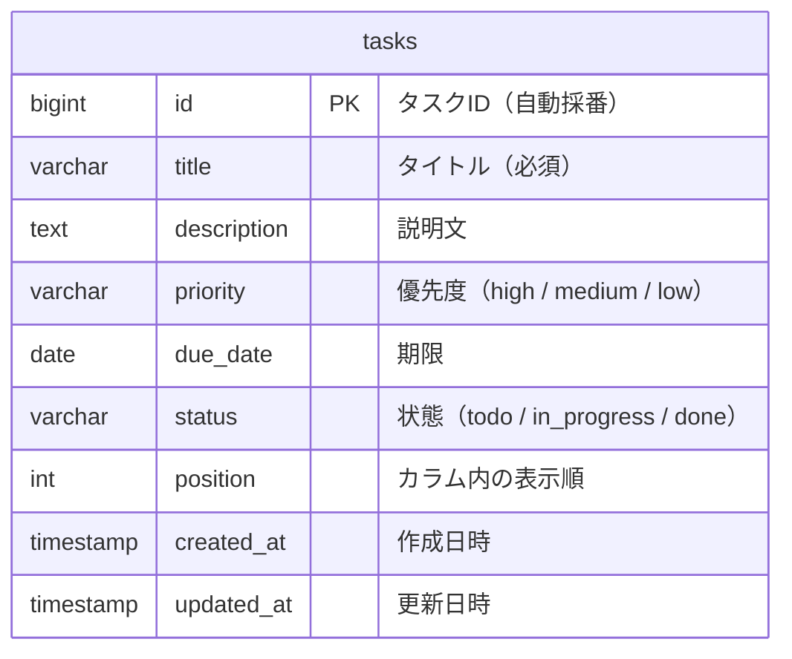

# データベース設計

保存先は PostgreSQL。タスクは `tasks` テーブルの1行である。

## 1. ER図

## 2. テーブル定義

### 2.1 tasks テーブル

| カラム名 | 型 | 必須 | デフォルト | 説明 |
| --- | --- | --- | --- | --- |
| id | bigint | YES | | 主キー。自動採番 |
| title | varchar(255) | YES | | タスクのタイトル |
| description | text | NO | NULL | タスクの説明文 |
| priority | varchar(10) | YES | medium | 優先度（high / medium / low） |
| due_date | date | NO | NULL | 期限 |
| status | varchar(20) | YES | todo | 状態（todo / in_progress / done） |
| position | int | YES | 0 | カラム内の表示順 |
| created_at | timestamp | YES | 現在時刻 | 作成日時 |
| updated_at | timestamp | YES | 現在時刻 | 更新日時 |

画面の列との対応は、`todo` が「やること」、`in_progress` が「進行中」、`done` が「完了」である。

### 2.2 インデックス

| インデックス名 | カラム | 用途 |
| --- | --- | --- |
| PRIMARY | id | 主キー |
| idx_tasks_status | status | 状態ごとのタスク取得 |
| idx_tasks_status_position | status, position | カラム内の表示順でのソート |

### 2.3 制約

- `priority` は `high`、`medium`、`low` のいずれか
- `status` は `todo`、`in_progress`、`done` のいずれか
- `title` は空文字を許可しない
