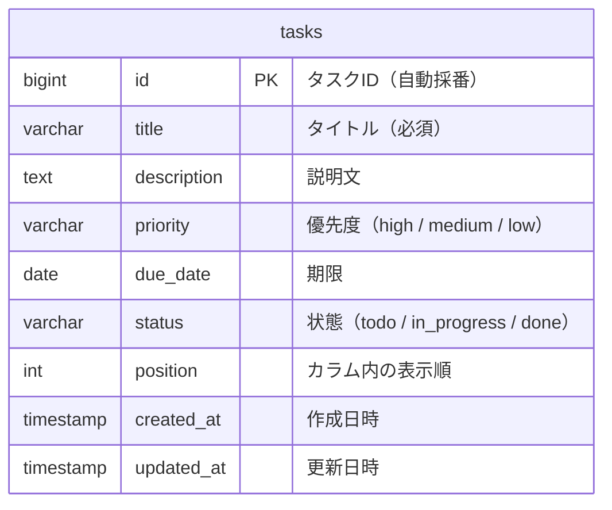

# データベース設計

保存先は PostgreSQL である。タスク1件が、`tasks` テーブルの1行になる。

## 1. ER図



## 2. テーブル定義

### 2.1 tasks テーブル

| カラム名 | 型 | 必須 | デフォルト | 説明 |
| --- | --- | --- | --- | --- |
| id | bigint | YES | 自動採番 | 主キー |
| title | varchar(255) | YES | なし | タスクのタイトル |
| description | text | NO | NULL | タスクの説明文 |
| priority | varchar(10) | YES | `'medium'` | 優先度（high / medium / low） |
| due_date | date | NO | NULL | 期限 |
| status | varchar(20) | YES | `'todo'` | 状態（todo / in_progress / done） |
| position | int | YES | `0` | カラム内の表示順。0 からで、小さいほうが上 |
| created_at | timestamp | YES | `CURRENT_TIMESTAMP` | 作成日時 |
| updated_at | timestamp | YES | `CURRENT_TIMESTAMP` | 更新日時。アプリから更新したときに、その時刻へ書き換える |

デフォルト値は、テーブルの列に設定している。アプリを通さず SQL で行を入れたときも、省略した列にはこの値が入る。

画面の列との対応は、次のとおりである。

| status | 画面の列 |
| --- | --- |
| `todo` | やること |
| `in_progress` | 進行中 |
| `done` | 完了 |

### 2.2 インデックス

| インデックス名 | カラム | 用途 |
| --- | --- | --- |
| PRIMARY | id | 主キー |
| idx_tasks_status | status | 状態ごとのタスク取得 |
| idx_tasks_status_position | status, position | カラム内の表示順でのソート |

### 2.3 制約

CHECK 制約で、次を守る。

- `priority` は `high`、`medium`、`low` のいずれか
- `status` は `todo`、`in_progress`、`done` のいずれか
- `title` は空文字を許可しない

| 制約名 | 内容 | 作るもの |
| --- | --- | --- |
| `tasks_values_check` | 上の3つすべて | `data.sql` |
| `tasks_priority_check` | `priority` の値 | Spring Boot（JPA）が、Java の列挙型から自動で作る |
| `tasks_status_check` | `status` の値 | Spring Boot（JPA）が、Java の列挙型から自動で作る |

## 3. テーブルの作成と初期データ

| 内容 | 担当 | 場所 |
| --- | --- | --- |
| テーブル、列、インデックス | Spring Boot（JPA）が、起動時に `Task` クラスから作る | `backend/src/main/java/com/taskmanagement/entity/Task.java` |
| 制約、デフォルト値 | 起動時に SQL で設定する | `backend/src/main/resources/data.sql` |
| 初期データ | `tasks` が空のときだけ、各列2件ずつ計6件を入れる | `backend/src/main/resources/data.sql` |
| 検索を試すためのテストデータ | 手動で流す。同じタイトルは二重に入らない | `backend/db/test-data.sql` |

テストデータは、`TaskManagement` フォルダで次のように流す。

```
docker compose exec -T db psql -U taskboard -d taskboard < backend/db/test-data.sql
```

## 4. 接続先（開発環境）

開発環境では、PostgreSQL を Docker で動かす。コンテナ内の 5432 を、PC の 5433 へ出す。

| 項目 | 値 |
| --- | --- |
| ホスト / ポート | `localhost:5433` |
| データベース名 | `taskboard` |
| ユーザー | `taskboard` |
| パスワード | `taskboard` |

これは開発環境専用の値である。本番環境では、推測されにくいパスワードを使い、設定ファイルに直接書かずに環境変数などで渡す。

設定は `docker-compose.yml` と `backend/src/main/resources/application.yml` にある。
