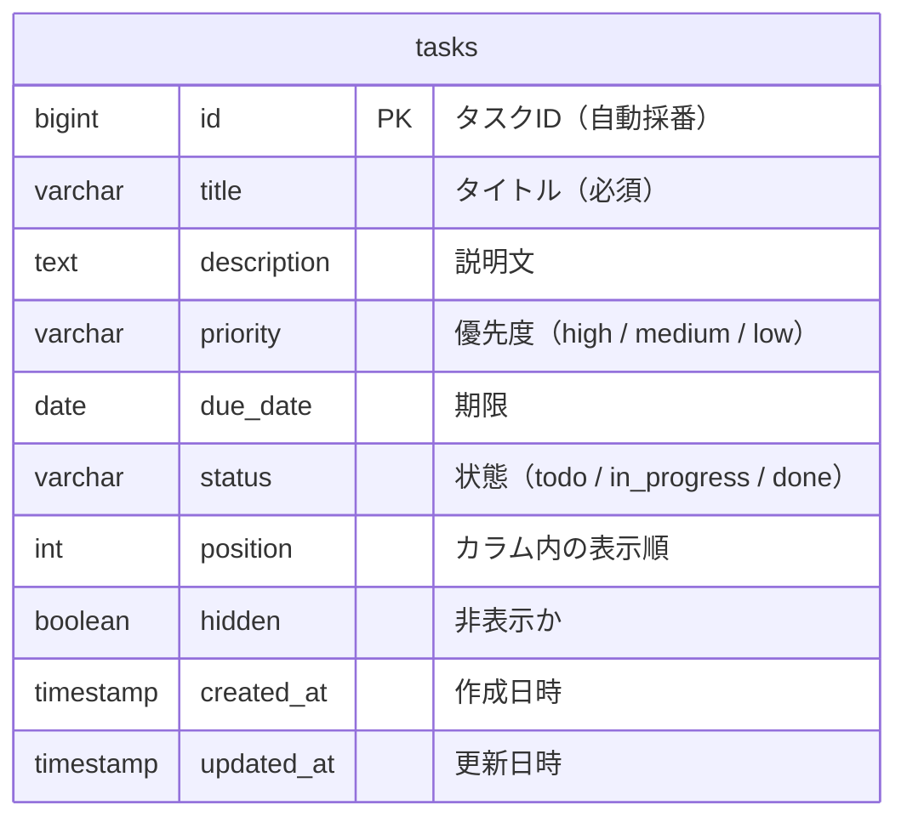

# データベース設計

保存先は PostgreSQL である。タスク1件が、`tasks` テーブルの1行になる。

## 1. ER図



## 2. テーブル定義

### 2.1 tasks テーブル

| カラム名 | 型 | 必須 | デフォルト | 説明 |
| --- | --- | --- | --- | --- |
| id | bigint | YES | 自動採番 | 主キー |
| title | varchar(255) | YES | なし | タスクのタイトル |
| description | text | NO | NULL | タスクの説明文 |
| priority | varchar(10) | YES | `'medium'` | 優先度（high / medium / low） |
| due_date | date | NO | NULL | 期限 |
| status | varchar(20) | YES | `'todo'` | 状態（todo / in_progress / done） |
| position | int | YES | `0` | カラム内の表示順。0 からで、小さいほうが上。非表示のタスクも、この並びの中に残る |
| hidden | boolean | YES | `false` | 非表示か。`true` のタスクはボードに出さず、非表示欄に出す |
| created_at | timestamp | YES | `CURRENT_TIMESTAMP` | 作成日時 |
| updated_at | timestamp | YES | `CURRENT_TIMESTAMP` | 更新日時。アプリから更新したときに、その時刻へ書き換える |

デフォルト値は、テーブルの列に設定している。アプリを通さず SQL で行を入れたときも、省略した列にはこの値が入る。

画面の列との対応は、次のとおりである。

| status | 画面の列 |
| --- | --- |
| `todo` | やること |
| `in_progress` | 進行中 |
| `done` | 完了 |

### 2.2 インデックス

| インデックス名 | カラム | 用途 |
| --- | --- | --- |
| PRIMARY | id | 主キー |
| idx_tasks_status | status | 状態ごとのタスク取得 |
| idx_tasks_status_position | status, position | カラム内の表示順でのソート |

### 2.3 制約

CHECK 制約で、次を守る。

- `priority` は `high`、`medium`、`low` のいずれか
- `status` は `todo`、`in_progress`、`done` のいずれか
- `title` は空文字を許可しない

| 制約名 | 内容 | 作るもの |
| --- | --- | --- |
| `tasks_values_check` | 上の3つすべて | Flyway の `V1__create_tasks.sql` |

以前は、同じ意味の `tasks_priority_check` と `tasks_status_check` も付いていた（Hibernate が自動で作っていたもの）。重なっていたので、`V2__remove_duplicate_checks.sql` で外した。

## 3. テーブルの作成と初期データ

テーブルは **Flyway**（マイグレーションの道具）で作り、変える。変更は、版番号を付けた SQL ファイルで管理する。API を起動すると、Flyway がまだ流していない版だけを番号の順に流し、流した記録をデータベースの `flyway_schema_history` テーブルに残す。

| 内容 | 担当 | 場所（`backend/src/main/resources/db/migration/`） |
| --- | --- | --- |
| テーブル、列、デフォルト値、制約、インデックス | Flyway の V1。新しいデータベースでだけ流れる | `V1__create_tasks.sql` |
| 重なっていた CHECK 制約を外す | Flyway の V2 | `V2__remove_duplicate_checks.sql` |
| 初期データ | Flyway が起動のたびに、マイグレーションのあとで流す。`tasks` が空のときだけ、各列2件ずつ計6件を入れる | `afterMigrate.sql` |
| 検索を試すためのテストデータ | 手動で流す。同じタイトルは二重に入らない | `backend/db/test-data.sql` |

- Hibernate（JPA）はテーブルを作らない。起動時に、`Task` クラスとテーブルが合っているかだけを確かめる（`application.yml` の `ddl-auto: validate`）。合わなければ API は起動しない。
- Flyway を入れる前からあるデータベース（テーブルはあるが、Flyway の記録が無い）は、はじめて起動したときに「V1 まで済み」として記録する（`baseline-on-migrate`）。V1 は流さないので、データはそのまま残る。
- テーブルを変えるときは、流し済みの SQL は書き換えない。次の番号のファイル（例：`V3__add_xxx.sql`）を足し、`Task` クラスも合わせて直す。

流し済みの版は、次のように確かめられる。

```
docker compose exec -T db psql -U taskboard -d taskboard -c "SELECT version, description, installed_on FROM flyway_schema_history ORDER BY installed_rank"
```

テストデータは、`TaskManagement` フォルダで次のように流す。

```
docker compose exec -T db psql -U taskboard -d taskboard < backend/db/test-data.sql
```

## 4. 接続先（開発環境）

開発環境では、PostgreSQL を Docker で動かす。コンテナ内の 5432 を、PC の 5433 へ出す。

| 項目 | 値 |
| --- | --- |
| ホスト / ポート | `localhost:5433` |
| データベース名 | `taskboard` |
| ユーザー | `taskboard` |
| パスワード | `taskboard` |

これは開発環境専用の値である。本番環境では、推測されにくいパスワードを使い、設定ファイルに直接書かずに環境変数で渡す。

設定は `docker-compose.yml` と `backend/src/main/resources/application.yml` にある。API の接続先は、次の環境変数があればそれを使い、無ければ上の開発用の値を使う。

| 環境変数 | 意味 | 無いときの値 |
| --- | --- | --- |
| `DB_URL` | 接続先の URL | `jdbc:postgresql://localhost:5433/taskboard` |
| `DB_USERNAME` | ユーザー | `taskboard` |
| `DB_PASSWORD` | パスワード | `taskboard` |

## 5. データの退避と戻し方

データをまとめて退避したり、戻したりするときは、PostgreSQL に付いている道具を使う（API にまとめて置き換える入口は無い）。`TaskManagement` フォルダで次のように打つ。

| やること | コマンド |
| --- | --- |
| 退避する（テーブルの形とデータを SQL のファイルに書き出す） | `docker compose exec -T db pg_dump -U taskboard -d taskboard --clean --if-exists > backup.sql` |
| 戻す（退避したときの状態に入れ直す） | `docker compose exec -T db psql -U taskboard -d taskboard < backup.sql` |

- `--clean --if-exists` を付けて退避すると、戻すときに今のテーブルを消してから作り直すので、退避したときと同じ状態に戻る。Flyway の記録（`flyway_schema_history`）も一緒に戻る
- 戻す前に API を止めておく（使っている途中のデータが混ざらないようにする）
- 退避したファイルには、すべてのデータが入っている。Git には入れない
