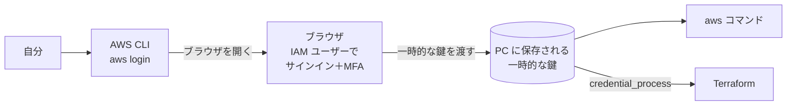
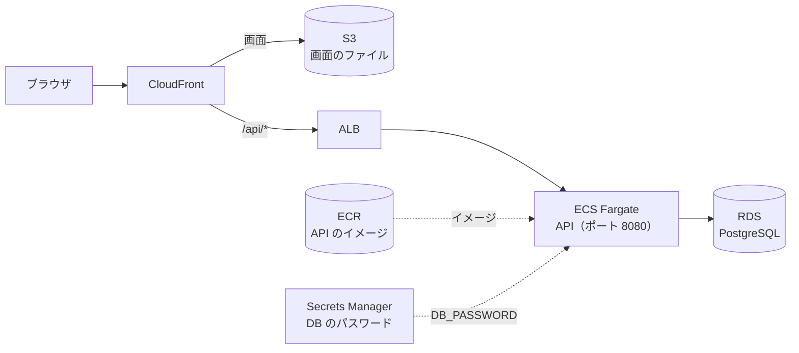

# AWS へのデプロイの準備

タスクボードを AWS で動かすための、解説と検討のメモ。マネジメントコンソール（ブラウザの管理画面）での手作業をなるべく減らし、**AWS CLI と Terraform を使い、AI（Claude Code）にコマンドを打たせる**進め方を考える。

## 目次

- [0. この文書の位置づけ](#0-この文書の位置づけ)
- [1. 用語の解説](#1-用語の解説)
- [2. 最初に行う安全対策](#2-最初に行う安全対策)
- [3. 道具の入れ方](#3-道具の入れ方)
- [4. 認証と IAM](#4-認証と-iam)
- [5. 構成の候補](#5-構成の候補)
- [6. Terraform のフォルダ構成の候補](#6-terraform-のフォルダ構成の候補)
- [7. AI に任せるときのルール案](#7-ai-に任せるときのルール案)
- [8. この先の進め方](#8-この先の進め方)
- [9. メンターに確認すること](#9-メンターに確認すること)
- [10. 出典](#10-出典)

## 0. この文書の位置づけ

今は **読んで理解する段階** である。AWS にはまだ接続しておらず、何も作っていない。この文書の AWS のコマンドは説明のために載せていて、実行したことはない。

| 項目 | 状態（2026-11-26） |
| --- | --- |
| AWS アカウント | 作成した。有効化は済んでいない（2026-11-20 時点）。プランや登録方法は未確認 |
| 認証方法と IAM の設定 | 【回答待ち】メンターの回答を待っている。手順の候補は [4](#4-認証と-iam) に書いた（実行はしていない） |
| AWS の構成 | 【候補】講義での指定をまだ確認していないので、何も決めていない |
| AWS CLI と Terraform | PC に入れた（[3](#3-道具の入れ方)） |
| アプリのコード | デプロイのための変更はしていない |

文中では、次の印で確かさを区別する。

| 印 | 意味 |
| --- | --- |
| 【確認済み】 | 公式ページの本文か、このリポジトリのファイルで確かめた。ページの内容を確かめたもので、AWS で動かして確かめたものではない |
| 【未確認】 | 検索結果の要約・第三者の記事・一般的な知識・概算によるもの。使う前に確かめる |
| 【回答待ち】 | メンターの回答を待って決める |
| 【候補】 | 案の1つ。決まったことではない |

## 1. 用語の解説

この章は考え方をつかむための一般的な説明である。

### AWS

Amazon のクラウドサービス。サーバー・データベース・ファイルの置き場所などを、インターネット越しに借りる。自分で機械を買わなくてよく、要らなくなったら消せる。多くは使った分だけ料金がかかる。

- **リージョン**：データセンターがある地域。東京は `ap-northeast-1`。多くのサービスは、作ったものがリージョンごとに分かれる。東京を使うことは【候補】。
- **サービス**：AWS の部品。サーバーなら EC2、データベースなら RDS、ファイル置き場なら S3、のように名前が付いている。

### マネジメントコンソールと AWS CLI

| 方法 | どうやるか | 良いところ | 困るところ |
| --- | --- | --- | --- |
| マネジメントコンソール | ブラウザの画面でボタンを押す | 見て分かりやすい | 同じ操作を正確にくり返すのが大変 |
| AWS CLI | コマンド（`aws ...`）を打つ | 手順を文字で残せる。AI も実行できる | コマンドを覚える必要がある |

### IaC

Infrastructure as Code の略。サーバーやネットワークなどの**インフラ（土台）の構成を、コードで書く**考え方。アプリのコードと同じように Git で管理できる。

| 比べること | 手作業（コンソール） | IaC |
| --- | --- | --- |
| もう一度同じものを作る | 手順を思い出して、また押す | 同じコードから作れる |
| 変更の理由や経緯 | 別にメモしないと残りにくい | Git の履歴や PR に残せる |
| ほかの人の確認 | 画面や設定を見てもらう | PR でコードを見てもらえる |
| 片づけ | 1つずつ探して消す | コードで管理しているものは、まとめて消せる |

### Terraform

IaC の道具の1つ（HashiCorp 社）。`.tf` ファイルに「**こういう状態にしたい**」と書くと、今の状態との差を調べて、作る・変える・消すを行う。

| 用語 | 意味 |
| --- | --- |
| provider | AWS などとつなぐための部品 |
| resource | 作るもの1つ1つ（S3 バケット、データベースなど） |
| variable | 外から渡す値。同じコードで値だけ変えられる |
| output | 作ったあとに表示したい値（画面の URL など） |
| state | Terraform が「何を作ったか」を覚えておくデータ。パスワードなどの秘密が入ることがある |

基本の流れ：

| 順番 | コマンド | すること | AWS への接続 |
| --- | --- | --- | --- |
| 1 | `terraform init` | provider をダウンロードして準備する | state を S3 に置く設定なら、接続する |
| 2 | `terraform fmt` | `.tf` の見た目を整える | しない |
| 3 | `terraform validate` | 書き方に間違いがないか確かめる | しない |
| 4 | `terraform plan` | 作る・変える・消すものの**予告**を出す。変更は行わない【確認済み】 | **する**（今の状態を読む） |
| 5 | `terraform apply` | 予告の内容を実行する | **する**（料金がかかるものを作ることがある） |
| 6 | `terraform destroy` | その設定で管理しているものを消す【確認済み】 | **する** |

`destroy` が消すのは、その Terraform の設定で管理しているものだけ。手で作ったものや、別の設定で作ったもの（state 用の S3 など）は残る。消したあとも、何か残っていないか、料金がかかっていないかを確かめる。

書き方の例（説明用。このまま実行しない）：

```hcl
terraform {
  required_version = ">= 1.17" # この PC に入れた版に合わせた例
  required_providers {
    aws = {
      source = "hashicorp/aws" # 実際に書くときは、版も指定する
    }
  }
}

# 東京リージョンを使う例。認証の設定は回答待ちなので書いていない
provider "aws" {
  region = "ap-northeast-1"
}

# 作るもの：S3 バケット（ファイル置き場）
resource "aws_s3_bucket" "frontend" {
  bucket = "taskboard-frontend-example" # ほかと重ならない名前にする
}

# 作ったあとに表示する値
output "bucket_name" {
  value = aws_s3_bucket.frontend.bucket
}
```

- `resource "種類" "呼び名"` の形で書く。種類は provider が決めていて、呼び名は自分で決める。
- ほかの resource の値は `種類.呼び名.項目` の形で使える。

### ほかの IaC の道具

AWS には、CloudFormation（YAML や JSON で書く）と、CDK（TypeScript などのプログラムで書く）もある。この文書は、この作業の方針に合わせて Terraform で説明する。

## 2. 最初に行う安全対策

アカウントの有効化が済んでから行う。**まだ行っていない。** 認証の設定が決まるまでは CLI を使えないので、最初はコンソールで行う想定。

### 2-1. アカウントの状態を確かめる

- AWS からのメール、支払い方法、電話番号の確認が済んでいるか。
- 登録方法（新しい登録か、advanced か）、プラン（無料か有料か）、残りのクレジット。
- 有効化が終わらないときは、AWS サポートかメンターに相談する。

### 2-2. ルートユーザーを守る

- **ルートユーザー**：アカウントを作ったときのメールアドレスでログインするユーザー。とても強い権限を持つ。
- **MFA（多要素認証）**：パスワードに加えて、スマホの認証アプリの数字などでも本人を確かめる仕組み。
- AWS は、ルートユーザーの情報を個人情報と同じように守ることと、MFA を使うことをすすめている【確認済み】。
- 普段の作業に使うユーザーは【回答待ち】（[4](#4-認証と-iam)）。

### 2-3. 予算アラートを作る

AWS Budgets には、次のテンプレートがある【確認済み】。

| テンプレート | 内容 |
| --- | --- |
| ゼロ支出予算（Zero spend budget） | 使った額が無料利用枠を超えたら知らせる |
| 月次コスト予算（Monthly cost budget） | 決めた月の額を超えたとき、または超えそうなときに知らせる |

アラートは**知らせるだけ**と考え、届くまでに時間がかかることも見込んでおく【未確認】。料金を止めるには、自分で片づける。

### 2-4. 無料利用枠

新しいアカウントの無料プランについて、AWS のページに書かれていること【確認済み】。**自分のアカウントがこれに当てはまるかは未確認。**

- アカウントを作ると 100 ドル分のクレジットがもらえ、決められた操作をすると、さらに最大 100 ドル分もらえる。
- 無料プランは、6 か月たつか、クレジットを使い切ると終わる（早いほう）。終わるとアカウントは自動で閉じ、作ったものやデータを使えなくなる。
- そのあと 90 日のうちに有料プランにすれば、アカウントを使い続けられる。過ぎると、アカウントと中身は完全に消える。
- AWS Organizations に入ると、自動で有料プランになる。

クレジットの期限は、ページによって 6 か月とも 12 か月とも読めた【未確認】。自分のアカウントの画面で確かめる。

## 3. 道具の入れ方

PC に入れるだけなら、AWS の料金はかからない。**2026-11-20 に、この PC に入れて、動くことを確かめた。**

| 道具 | 入れた版 | 入れ方（Windows） | 確かめ方 |
| --- | --- | --- | --- |
| AWS CLI | 2.41.2 | `winget install -e --id Amazon.AWSCLI` | `aws --version` |
| Terraform | 1.17.1 | `winget install -e --id Hashicorp.Terraform` | `terraform version` |

- `-e` は、ID が完全に同じものだけを入れる指定。
- AWS CLI のインストールでは、変更の許可を求める画面が出ることがある。
- 「コマンドが見つからない」と出たら、VS Code やターミナルを開き直す。新しい PATH（コマンドを探す場所）が読み込まれる。
- `aws login` を使う場合は、AWS CLI が 2.32.0 以上必要【確認済み】。入れた版は満たしている。
- VS Code の拡張機能「HashiCorp Terraform」を入れると、`.tf` が読みやすくなる（入れなくてもよい）。

## 4. 認証と IAM

> **【回答待ち】** どの方法を使うか、IAM ユーザーにどの権限を付けるかは、メンターの回答を待っている。[4-1](#4-1-手順の候補aws-login-を使う場合) と [4-2](#4-2-手順の候補アクセスキーを使う場合) の手順は**候補として書いたもので、まだ実行しない**。回答が来たら、合う手順を選び、違う点を直してから進める。

### 用語

- **認証**：AWS に「このコマンドを打ったのは誰か」を証明すること。
- **IAM**：AWS で「誰が、何をしてよいか」を管理するサービス。
- **IAM ユーザー**：アカウントの中に作る、人や作業ごとのユーザー。ルートユーザーより弱い権限にできる。
- **ポリシー**：「何をしてよいか」を書いた権限のまとまり。IAM ユーザーに付ける。
- **最小権限**：必要なことだけができる権限にする考え方。
- **一時的な認証情報**：期限が来ると使えなくなる鍵。
- **アクセスキー**：自動では切れず、消したり無効にしたりするまで使える鍵。
- **プロファイル**：AWS CLI の接続の設定に付ける名前。`--profile taskboard` のように指定して、設定を使い分ける。

### AWS の一般的なすすめ

【確認済み】AWS の IAM のページには、次のように書かれている。この課題での設定は【回答待ち】。

- 人が使うときは、一時的な認証情報を使う。
- アクセスキーのような長く使える鍵を作るより、一時的な認証情報に頼る。
- 権限は、作業に必要な分だけ与える。

### 認証方法の候補

順番は、おすすめの順ではない。

| 候補 | しくみ | 分かっていること | まだ分からないこと |
| --- | --- | --- | --- |
| `aws login` | コンソールと同じログインで、一時的な認証情報を使う | CLI 2.32.0 以上。IAM ユーザーなどには `SignInLocalDevelopmentAccess` が要る。1回のログインは最大 12 時間【確認済み】 | 自分のプランで使えるか。Terraform からそのまま使えるか |
| IAM Identity Center | 専用の画面からログインし、一時的な認証情報を使う | 下の「Identity Center の注意」を参照 | 自分のアカウントで使えるか |
| アクセスキー | 鍵を作って PC に保存する | AWS は一時的な認証情報のほうをすすめている【確認済み】 | 講義で指定されているか |

`aws login` と Terraform について：

- state を S3 に置く機能（S3 backend）は、Terraform 1.15.0 から `aws login` に対応した、と Terraform の変更履歴にある【確認済み】。この PC の 1.17.1 は満たしている。
- AWS provider（AWS とつなぐ部品）については、第三者の記事に「6.23.0 以上で対応」とあるが、provider の変更履歴を読んだ範囲では見つからなかった【未確認】。
- そのため 4-1 では、AWS の公式ページにある `credential_process`（AWS CLI から鍵を受け取るしくみ）を使う手順にした。

### Identity Center の注意

【確認済み】

- 「Sign up for AWS (new)」（新しい登録方法）のページでは、IAM Identity Center と AWS Organizations は、**Activate advanced AWS features をしない限り使えない**ものに入っている。
- Activate advanced AWS features は、**一度行うと元に戻せない**。
- Organizations を使わない「アカウントインスタンス」もあるが、AWS アカウントへログインする用途（AWS access portal）には対応していない。

【未確認】Activate advanced AWS features で、有料プランに変わるかどうか。ページには書かれていなかった。

**回答があるまで、Activate advanced AWS features と Organizations の作成は行わない。** このため、Identity Center の手順は書いていない。

### 4-1. 手順の候補：`aws login` を使う場合

AWS がすすめる「一時的な認証情報」を使う方法。元に戻せない操作が無く、入れた AWS CLI の版（2.41.2）で使える。

#### 全体の流れ



| 順番 | やること | どこで | 誰が |
| --- | --- | --- | --- |
| 1 | ルートユーザーに MFA を付ける（[2-2](#2-2-ルートユーザーを守る)） | コンソール | 自分 |
| 2 | 作業用の IAM ユーザーを作る | コンソール（ルートユーザー） | 自分 |
| 3 | IAM ユーザーにも MFA を付ける | コンソール（IAM ユーザー） | 自分 |
| 4 | `aws login` でログインする | PC のターミナル | 自分 |
| 5 | だれとしてつながったかを確かめる | PC のターミナル | 自分か AI |
| 6 | Terraform 用のプロファイルを作る | PC のファイル | 自分か AI |
| 7 | 作業が終わったら `aws logout` する | PC のターミナル | 自分か AI |

1〜3 をコンソールで行うのは、この時点では PC に鍵が無く、CLI を使えないため。ルートユーザーで CLI を使うことは避ける。

#### 手順 2・3：作業用の IAM ユーザーを作る

画面の名前やボタンの場所は変わることがある【未確認】。

1. ルートユーザーでマネジメントコンソールにサインインする。
2. IAM のページで「ユーザー」→「ユーザーの作成」を選ぶ。
3. ユーザー名を決める（例：`taskboard-admin`）。
4. 「マネジメントコンソールへのアクセス」を有効にする。`aws login` は、コンソールと同じサインインを使うため。
5. 権限を付ける。
   - `SignInLocalDevelopmentAccess`：`aws login` に必要【確認済み】。
   - 作業に使う権限：【回答待ち】（下の表）。
6. 作ったら、サインイン用の URL とパスワードを、パスワード管理アプリなどに控える。チャットには貼らない。
7. コンソールからサインアウトし、IAM ユーザーでサインインし直して、MFA を登録する。

作業に使う権限の考え方（どれにするかは【回答待ち】）：

| 付け方 | 良いところ | 困るところ |
| --- | --- | --- |
| `AdministratorAccess`（ほぼ何でもできる） | 権限が足りないエラーが出ない | AI が間違えたときに、何でも消せてしまう |
| 使うサービスだけの権限 | 間違えたときの影響が小さい | 足りないと途中でエラーになり、足す作業が要る |

#### 手順 4：`aws login` でログインする

VS Code のターミナル（PowerShell）で打つ。ブラウザでのサインインは自分で行う。

```powershell
aws login --profile taskboard
```

- ブラウザが開くので、`taskboard-admin` でサインインし、MFA の数字を入れる。
- リージョンを聞かれたら `ap-northeast-1`（東京）と答える。あとから変えるときは `aws configure set region ap-northeast-1 --profile taskboard`。
- ブラウザが使えない環境では `aws login --remote` を使う。表示された URL を別の機器で開き、出てきたコードを CLI に貼る【確認済み】。

ログインすると、`%USERPROFILE%\.aws\config`（`C:\Users\<名前>\.aws\config`）に次のような設定が書かれる【確認済み】。

```ini
[profile taskboard]
login_session = arn:aws:iam::<アカウントID>:user/taskboard-admin
region = ap-northeast-1
```

- 一時的な鍵は `%USERPROFILE%\.aws\login\cache` に保存される【確認済み】。
- 鍵は必要に応じて 15 分ごとに自動で新しくなる。ログインは最大 12 時間で切れ、そのあとはもう一度 `aws login` を打つ【確認済み】。

#### 手順 5：だれとしてつながったかを確かめる

```powershell
aws sts get-caller-identity --profile taskboard
```

- 「今、だれとして AWS につながっているか」を表示するだけで、何も作らない。料金はかからない【未確認：一般的な知識】。
- 表示の `Arn` の最後が `user/taskboard-admin` なら成功。`root` と出たら、ルートユーザーでつながっているので、そこで止めて `aws logout` する。
- 表示されるアカウント ID は、公開の場所（GitHub など）に貼らない。

#### 手順 6：Terraform から使う

`%USERPROFILE%\.aws\config` に、Terraform 用のプロファイル `taskboard-tf` を書き足す【確認済み：AWS の公式ページの方法】。

```ini
[profile taskboard]
login_session = arn:aws:iam::<アカウントID>:user/taskboard-admin
region = ap-northeast-1

[profile taskboard-tf]
credential_process = aws configure export-credentials --profile taskboard --format process
region = ap-northeast-1
```

- `credential_process` は、「鍵が要るときは、このコマンドを実行して鍵をもらう」という設定。Terraform は、AWS CLI から `taskboard` の一時的な鍵を受け取る。
- 先に `aws login --profile taskboard` でログインしておく。
- 使う前に `aws sts get-caller-identity --profile taskboard-tf` で、同じユーザーが表示されるかを確かめる。

Terraform を動かすターミナルで、使うプロファイルを環境変数で指定する。

```powershell
$env:AWS_PROFILE = "taskboard-tf"
terraform plan
```

- `$env:AWS_PROFILE` は、そのターミナルを閉じるまで有効。新しいターミナルでは、もう一度指定する。
- `.tf` のファイルにはプロファイル名を書かない。人によって PC の設定が違うので、コードは同じまま、環境変数で切り替える。

#### 手順 7：作業が終わったら

```powershell
aws logout --profile taskboard
```

すべてのプロファイルからログアウトするときは `aws logout --all`【確認済み】。

### 4-2. 手順の候補：アクセスキーを使う場合

講義やメンターから指定されたときだけ使う。AWS は 4-1 のような一時的な認証情報をすすめている【確認済み】。

1. 4-1 の手順 2・3 と同じように IAM ユーザーを作る（`SignInLocalDevelopmentAccess` は要らない）。
2. IAM ユーザーのページで、アクセスキーを作る（用途は「CLI」）。シークレットアクセスキーは、作ったときにしか表示されない【未確認】。
3. **自分で**ターミナルに次を打ち、聞かれた値を入れる。AI には打たせない（チャットに鍵が残るため）。

   ```powershell
   aws configure --profile taskboard
   ```

   | 聞かれること | 入れる値 |
   | --- | --- |
   | AWS Access Key ID | 作ったアクセスキー ID |
   | AWS Secret Access Key | 作ったシークレットアクセスキー |
   | Default region name | `ap-northeast-1` |
   | Default output format | `json` |

4. 鍵は `%USERPROFILE%\.aws\credentials` に、**暗号化されずに**保存される【未確認：一般的な知識】。
5. 4-1 の手順 5 と同じく `aws sts get-caller-identity --profile taskboard` で確かめる。
6. Terraform では `$env:AWS_PROFILE = "taskboard"` と指定する。
7. 課題が終わったら、アクセスキーを無効にして削除する。この鍵は、消すまで期限が来ない。

### 4-3. AI（Claude Code）と認証の関係

- AI が `aws` や `terraform` を打つと、**自分のプロファイルの権限で動く**。AI だけの別の権限は無い。つまり、IAM ユーザーに付けた権限が、そのまま AI のできることになる。
- AI は PC のファイルを読めるので、`.aws` の中の鍵を読む可能性がある。Claude Code の permissions の `deny` で、`~/.aws/` を読めないようにすることを検討する【候補】。書き方は入れるときに公式ページで確かめる。
- AI に打たせるのは、手順 5〜7 のような確認や片づけ、許可した `plan`・`apply` まで（[7](#7-ai-に任せるときのルール案)）。

### どの方法でも守ること

- パスワード、アクセスキー、MFA の数字を、コード・`answers.md`・チャット（AI を含む）に貼らない。
- 認証情報を Git に入れない。`.aws` のフォルダはリポジトリの外（`C:\Users\<名前>\.aws`）にあるので、ふつうは Git に入らない。
- 自分の PC 以外（共有の PC など）でログインしたら、必ずログアウトする。

## 5. 構成の候補

> **【候補】** 講義で指定されている構成を、まだ確認していない。この章の構成・サービス・設定はすべて候補で、どれを使うかは決めていない。指定があれば、それに合わせる。

### 候補の比較

料金は、東京リージョンで1か月動かし続けたときの**概算**で、AWS の料金ページで確かめていない【未確認】。1 ドル = 150 円と仮に置いた。[AWS Pricing Calculator](https://calculator.aws/) で確かめてから判断する。

| 候補 | 構成 | 月の概算 | 特徴 |
| --- | --- | --- | --- |
| A | S3 + CloudFront、ALB + ECS Fargate、RDS | 70〜80 ドル（1.1 万円前後） | サーバーの OS を自分で管理しない。部品が多い |
| B | EC2 1台で Docker Compose | 20 ドル前後（3 千円前後） | ローカルに近く単純。OS の管理やバックアップは自分で行う |
| C | ALB + EC2、RDS | 70 ドル前後（1 万円前後） | API のサーバーの OS と Java を自分で管理する |

### 候補 A の図



| 役割 | ローカル（今） | 候補 A |
| --- | --- | --- |
| 画面 | Vite（5173） | S3 のファイルを CloudFront が配る |
| `/api` の転送 | Vite の proxy | CloudFront が `/api/*` を ALB へ送る |
| API | Spring Boot（8080） | ECS Fargate のコンテナ（8080） |
| DB | Docker の PostgreSQL（5433） | RDS の PostgreSQL |

### 部品の説明

| 部品 | 一言でいうと |
| --- | --- |
| VPC | AWS の中の、自分用のネットワーク |
| サブネット | VPC を区切ったもの。インターネットと直接つながる「パブリック」と、つながらない「プライベート」がある |
| セキュリティグループ | 部品ごとに、通す通信を決める仕組み |
| S3 | ファイルの置き場所 |
| CloudFront | ファイルなどを利用者の近くから配る仕組み（CDN） |
| ALB | 届いた通信を、動いているサーバーやコンテナに振り分ける |
| EC2 | 借りて使うサーバー |
| ECR | Docker イメージの置き場所 |
| ECS Fargate | サーバーを自分で管理せずに、コンテナを動かす仕組み |
| RDS | 運用の多くを AWS に任せられるデータベース |
| Secrets Manager | パスワードなどの秘密をしまう場所 |
| CloudWatch Logs | ログの置き場所 |

「Sign up for AWS (new)」のページの無料利用枠の一覧には、EC2・ECS・RDS・Elastic Load Balancing・S3・CloudFront・ECR・Secrets Manager・CloudWatch の名前がある。Fargate と ALB は、個別の名前では書かれていない【確認済み】。一覧にあることは、無料で使い続けられるという意味ではない。

### デプロイ前に解決すること

**アプリのコードは、今回は変更しない。** どう直すかは、構成が決まってから別の Issue で決める。

#### 1. ログインが無い

タスクボードにはログインが無く、サーバーを開ける人は、だれでもボードを見て操作できる（[requirements.md](requirements.md)）【確認済み】。インターネットに公開すると、**URL を知った人がだれでもカードを見て、変えて、消せる**。

対策の候補（どれも【未確認】）：見られる人を IP アドレスで絞る、簡単なパスワードを付ける、ログインの機能を作る。公開する時間を短くしても危険は減るだけで、なくならない。決まるまでは、見られて困ることを入れない。

#### 2. CORS の見直しが要る可能性がある

CORS は、別のサイトの画面からの呼び出しを、ブラウザでどこまで許すかの決まり。

- API は `http://localhost:5173` だけを許可している（`WebConfig.java`）【確認済み】。
- 許可していない Origin からの POST は 403 で断る（`TaskControllerTest` の `postFromOtherOriginIsRejectedByCors`）【確認済み】。
- CloudFront の `AllViewerExceptHostHeader` という設定では、API 側に届く Host が、CloudFront ではなく転送先のドメインになる【確認済み】。

このため、画面と API を同じ CloudFront のドメインで出しても、設定によっては API が「別のサイトから来た」と判断し、追加・移動・削除などが 403 になる可能性がある。**AWS で試していないので【未確認】**。許可する Origin を環境変数で渡せるようにする、CloudFront の設定で合わせる、などが候補。

#### 3. API の Docker イメージ

候補 A では API の `Dockerfile` が必要になる。候補 B でも、API と画面をコンテナで動かすなら必要になる。今はどちらも無い。

#### 4. DB の接続先

API は、接続先を環境変数 `DB_URL`・`DB_USERNAME`・`DB_PASSWORD` から読める（`application.yml`）【確認済み】。RDS につないで動くかは【未確認】。

#### 5. ALB に直接アクセスされるのを防ぐ

候補 A で何もしないと、CloudFront を通らずに ALB へ直接アクセスされることがある。AWS のページには、次の方法がある【確認済み】。どれを使うかは【候補】。

- CloudFront だけが付ける秘密のヘッダーを、ALB で確かめる
- CloudFront の通信だけを、セキュリティグループで通す（AWS が管理するプレフィックスリスト）
- ALB をインターネットに出さず、CloudFront の VPC オリジンでつなぐ

### 料金で気をつけること

- 使い終わったら片づけ、残っていないか確かめる。
- パブリック IPv4 アドレスは、使っていなくても1つ1時間 0.005 ドルかかる【確認済み】。無料利用枠での扱いは【未確認】。
- NAT Gateway は、置いておくだけでも料金がかかる。公式ページの例は米国オハイオで1時間 0.045 ドル【確認済み】。東京の料金は【未確認】。
- RDS の大きさやマルチ AZ（予備を別の場所に置く設定）でも、料金は変わる。

## 6. Terraform のフォルダ構成の候補

> **【候補】** まだ作っていない。構成が決まってから見直す。

```
TaskManagement/
└── infra/
    ├── bootstrap/        … state を置く S3 バケット（先に1回だけ作る）
    ├── versions.tf       … Terraform と provider の版、state の置き場所
    ├── variables.tf      … 外から渡す値
    ├── outputs.tf        … 作ったあとに表示する値
    ├── network.tf        … ネットワーク
    ├── database.tf       … データベース
    ├── app.tf            … API
    └── frontend.tf       … 画面
```

- state を S3 に置く場合、`use_lockfile = true` で、同時に書き換えるのを防げる。以前の DynamoDB を使う方法は非推奨になっている【確認済み】。
- `.terraform.lock.hcl`（provider の版の記録）は、Git に入れることがすすめられている【確認済み】。
- Git に入れないもの：`.terraform/`、`*.tfstate`、`*.tfstate.*`、秘密を書いた `*.tfvars`。Terraform を書き始めるときに `.gitignore` へ足す（今は入っていない）。

## 7. AI に任せるときのルール案

> **【候補】** AI に使わせる権限は【回答待ち】。下の設定もまだ入れていない。

| 区分 | 内容 |
| --- | --- |
| AI がしてよい | `.tf` を書く。AWS に接続しない `fmt`・`validate` を実行し、結果を説明する |
| 人の許可を得てから | AWS への接続（`plan` や、読むだけの `aws` コマンドを含む）。作る・変える・消す操作（`apply`・`destroy` など） |
| 渡さない | パスワード、アクセスキー、MFA の数字 |

`apply` と `destroy` の前には、AI が `plan` の結果から次を見せ、人の許可を待つ。

- 作る・変える・消すものの数
- 消すものの名前と、消すとどうなるか
- 料金の概算と、確かめていない点

**最初に AWS へログインする前に**、次の2つを済ませる。

1. AI に使わせる権限を、メンターの回答をもとに決める。AI は、渡された権限でできることを何でも実行できてしまう。強い権限を渡すほど、間違えたときの影響も大きい。
2. Claude Code の permissions で、`terraform` と `aws` の操作を「毎回確認する（ask）」にする。

ask の設定は、コマンドの書き方によってはすり抜けることがあり、安全の境界にはならない、と公式ページにある【確認済み】。そのため、設定だけに頼らず、**権限を絞ることと、人が確かめることを組み合わせる**。

## 8. この先の進め方

1つずつ、別の Issue で進める。順番や中身は、メンターの回答で変わることがある。

| 順番 | やること | 状態 |
| --- | --- | --- |
| 1 | AWS CLI と Terraform を PC に入れる | 完了（2026-11-20） |
| 2 | [9](#9-メンターに確認すること) をメンターに確認する | IAM の設定は【回答待ち】。ほかはこれから |
| 3 | アカウントの有効化、登録方法、プランを確かめる | まだ |
| 4 | ルートユーザーの MFA と予算アラート | まだ |
| 5 | AI の ask の設定を入れる（[7](#7-ai-に任せるときのルール案)） | まだ |
| 6 | 認証と IAM を設定する（[4-1](#4-1-手順の候補aws-login-を使う場合) か [4-2](#4-2-手順の候補アクセスキーを使う場合)） | 【回答待ち】。手順の候補は書いた |
| 7 | 構成を決める | 講義での指定を確認してから |
| 8 | アプリの変更（[デプロイ前に解決すること](#デプロイ前に解決すること)） | まだ |
| 9 | Terraform を書き、`validate` する | まだ |
| 10 | `plan` → 許可 → `apply` → 動作確認 → 片づけ | まだ。**料金がかかることがある** |

## 9. メンターに確認すること

1. 認証方法は何を使うか。
2. IAM のユーザーや権限はどう設定するか。AI に使わせる権限は、どこまでにするか。
3. 講義で指定されている AWS の構成やサービスはあるか。
4. AWS CLI と Terraform で進めてよいか。
5. ログインの無いアプリを公開するとき、アクセスをどう制限するか。
6. 自分のアカウントのプランで、気をつけることはあるか。

## 10. 出典

### 本文を読んだページ

2026-11-20：

- [Choosing a plan（無料プランと有料プラン）](https://docs.aws.amazon.com/awsaccountbilling/latest/aboutv2/free-tier-plans.html)

2026-11-20 と 2026-11-24：

- [Supported AWS services for Sign up for AWS (new)](https://docs.aws.amazon.com/accounts/latest/reference/supported-services-sign-up-new.html)
- [Login for AWS local development using console credentials（`aws login`）](https://docs.aws.amazon.com/cli/latest/userguide/cli-configure-sign-in.html)

2026-11-24：

- [Activate advanced AWS features](https://docs.aws.amazon.com/accounts/latest/reference/activate-advanced-features.html)
- [Organization and account instances of IAM Identity Center](https://docs.aws.amazon.com/singlesignon/latest/userguide/identity-center-instances.html)
- [Security best practices in IAM](https://docs.aws.amazon.com/IAM/latest/UserGuide/best-practices.html)
- [Using a budget template](https://docs.aws.amazon.com/cost-management/latest/userguide/budget-templates.html)
- [Amazon VPC Pricing](https://aws.amazon.com/vpc/pricing/)
- [CloudFront の管理オリジンリクエストポリシー](https://docs.aws.amazon.com/AmazonCloudFront/latest/DeveloperGuide/using-managed-origin-request-policies.html)
- [Restrict access to Application Load Balancers](https://docs.aws.amazon.com/AmazonCloudFront/latest/DeveloperGuide/restrict-access-to-load-balancer.html)
- [Backend Type: s3 - Terraform](https://developer.hashicorp.com/terraform/language/backend/s3)
- [terraform plan](https://developer.hashicorp.com/terraform/cli/commands/plan)
- [terraform destroy](https://developer.hashicorp.com/terraform/cli/commands/destroy)
- [Dependency Lock File - Terraform](https://developer.hashicorp.com/terraform/language/files/dependency-lock)
- [Claude Code の permissions](https://code.claude.com/docs/en/permissions)

2026-11-26：

- [Login for AWS local development using console credentials（`aws login`）](https://docs.aws.amazon.com/cli/latest/userguide/cli-configure-sign-in.html)（コマンド、設定の保存場所、`aws logout`、`credential_process` を読み直した）
- [Terraform v1.15 の CHANGELOG](https://github.com/hashicorp/terraform/blob/v1.15/CHANGELOG.md)（S3 backend の `aws login` 対応）
- [Terraform AWS provider の CHANGELOG](https://github.com/hashicorp/terraform-provider-aws/blob/main/CHANGELOG.md)（`aws login` の記載は、6.30.0 以降の本文と、6.15.0〜6.29.0 の要約では見つからなかった）

ページは AI（Claude Code）が読み、関係する文を抜き出して確かめた。S3 backend と Claude Code のページは、最後の部分を要約で読んでいる。

### 検索結果の要約だけを見たもの

- [AWS Free Tier FAQs](https://aws.amazon.com/free/free-tier-faqs/)（クレジットの期限）
- [aws login と credential_process についての記事（Classmethod、第三者）](https://dev.classmethod.jp/articles/aws-login-default-profile-credential-process-error/)（AWS provider で必要な版）
