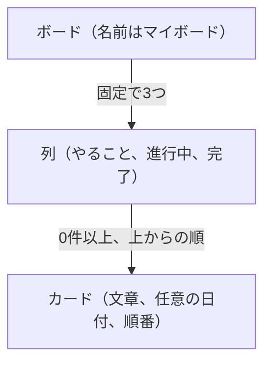
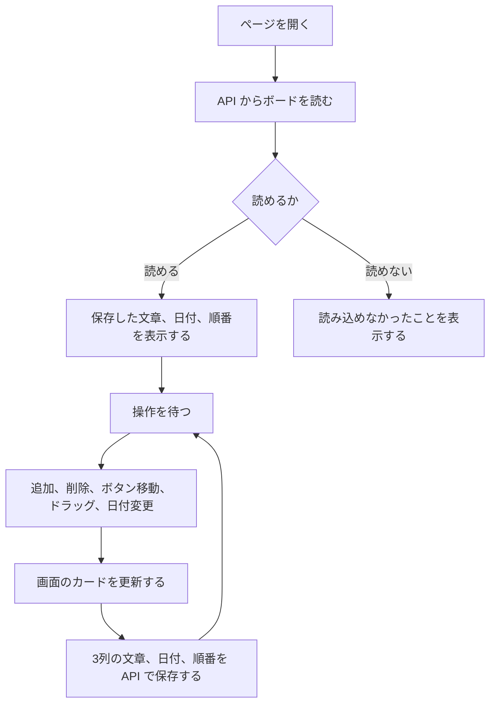

# 要件定義

## 1. 概要

1人の利用者が、ブラウザ上でタスクをカードとして並べ、進捗に合わせて列を移す。Trello のボードのうち、1枚のボードだけを対象にする。

## 2. 目的

やることを「やること」「進行中」「完了」に分け、今どの状態かを一目で分かるようにする。ページを閉じても、最後の並びが残る。

## 3. 利用者

PC、タブレット、スマートフォンのブラウザで、自分のタスクを管理する人。ログインはしない。

## 4. 前提

- 画面は React で作り、Spring Boot の API を通して PostgreSQL に保存する。
- ログインはしない。ボードは1つで、このサーバーを開くブラウザは同じボードを見る。
- 表示言語は日本語とする。

## 5. 用語

| 用語 | 意味 |
| --- | --- |
| ボード | 画面全体。名前は「マイボード」 |
| 列 | 進捗ごとのまとまり。やること、進行中、完了の3つ |
| カード | 1件のタスク。文章と、任意の日付を持つ |

## 6. 設計書の一覧

この文書は「何を作るか」を定める。「どう作るか」は次の文書で定める。

| 文書 | 内容 |
| --- | --- |
| [functional-requirements.md](functional-requirements.md) | 機能要件（F-01〜F-11）と API の仕様 |
| [screen-design.md](screen-design.md) | 画面の構成、画面の流れ、寸法と色、入力チェック、ドラッグの手順 |
| [database-design.md](database-design.md) | ER図、テーブル定義、初期データ、接続先 |
| [tech-stack.md](tech-stack.md) | 使う技術とバージョン |

## 7. データの流れ

カードが画面に出すのは、文章、任意の日付、列の中の順番である。データベースの `tasks` は、それに加えて説明、優先度、作成日時、更新日時を持つ。日付の通知や繰り返し、担当者、ラベルは持たせない。

ページを開いたときは、データベースから画面へ向かう。操作したときは、画面を先に更新し、その結果を API へ書く。

サーバーを起動したとき `tasks` が空なら、初期カードが入る。利用者がカードをすべて消したあとは、空のボードのまま残る。ただし、空のままサーバーを起動し直すと、初期カードが再び入る。

## 8. 非機能要件

### 対応環境

- 利用する端末は、PC、タブレット、スマートフォンとする。
- どの端末でも、ブラウザ上でカードの表示、追加、削除、ボタンによる移動、ドラッグによる移動と並び替えができる。
- 3列が画面に入りきらないときは、横スクロールで残りの列を見る。
- 保存はサーバーの PostgreSQL に残る。このサーバーを開く端末のあいだで、同じボードを見る。

### 性能

- 追加、削除、ボタン移動、ドラッグ移動の結果は、ページを再読み込みせず、操作から1秒以内に画面へ反映する。

### 信頼性

- 追加、削除、移動、ドラッグ、日付変更の直後に保存する。ページを閉じても、PostgreSQL にその並びが残る。
- API から読めないときは、読み込めなかったことを表示する。壊れたデータを直す機能は持たない。
- データベースのカードを消したときは、画面からも消え、戻す手段はない。
- 複数のタブで同時に編集したときは、最後に保存した内容が次に開いたときに残る。開いている別のタブへは自動では反映しない。

### セキュリティ

- カードの文章と日付は、入力された文字として表示する。HTML として解釈しない。
- ログインはない。このサーバーを開ける人は、だれでもボードを見て操作できる。

### 使用性

- 表示言語は日本語とする。
- 追加、削除、ボタンによる移動は、PC、タブレット、スマートフォンで操作できる。
- 列の間の移動と、同じ列の中の並び替えは、ドラッグで行う。

### 保守性

- 画面は React、API は Spring Boot、保存は PostgreSQL が担当する。
- 各技術のバージョンは [tech-stack.md](tech-stack.md) にまとめ、バージョンを上げたときは一緒に直す。

## 9. 技術選定

| 項目 | 採用 | 選んだ理由 |
| --- | --- | --- |
| バックエンド | Java、Spring Boot | タスクの読み書きを API で行う |
| フロントエンド | React、TypeScript、Vite | 追加、削除、移動、日付変更を1つの画面で処理する |
| データベース | PostgreSQL（Docker） | ページを閉じても、カードの文章、日付、順番が残る |
| ドラッグ | Pointer Events | マウスでもタッチでも、カードをつかんで移動できる |
| 文字の表示 | 文字列として画面に出す | HTML として解釈しない |
| 文字コード | UTF-8 | 日本語をそのまま保存し、表示できる |
| 開発時の起動 | Spring Boot と Vite | API は 8080、画面は 5173。画面からの `/api` は API へ転送する |

バージョンは [tech-stack.md](tech-stack.md) に書く。

## 10. 対象外

この版では、次はやらない。

- カードの文章をあとから編集すること（日付はあとから変えられる）
- 列の追加、名前の変更、削除
- ボードを複数作ること
- 利用者登録、ログイン、他の人との共有
- 日付の通知、繰り返し、チェックリスト、添付ファイル
