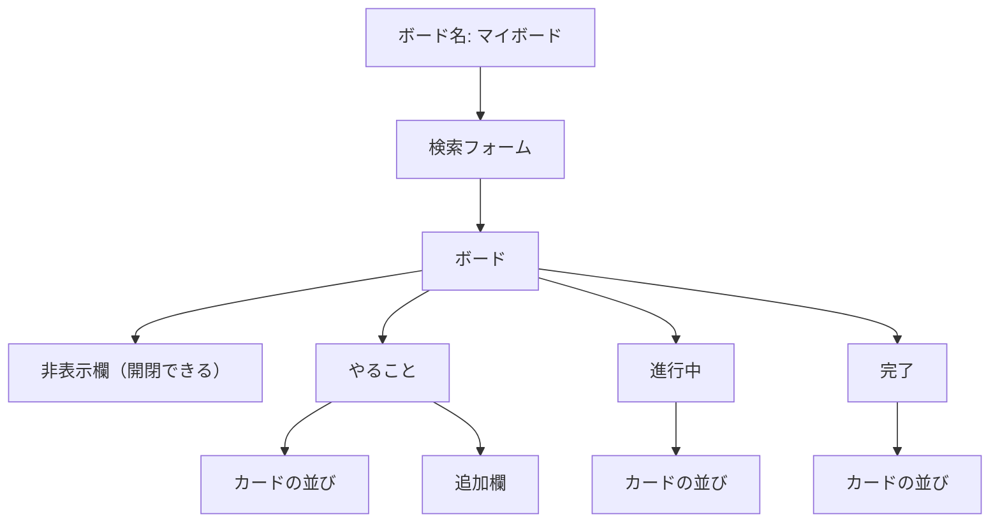
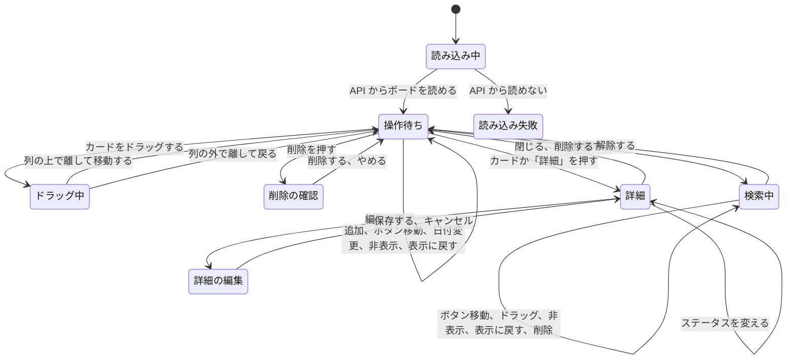

# 画面設計

機能の一覧は [functional-requirements.md](functional-requirements.md) に書く。この文書は、画面の構成、画面の流れ、見た目、入力チェック、ドラッグの手順を定める。

## 1. 画面一覧

ページは1つだけである。別のページへは遷移しない。

| ID | 画面名 | 役割 |
| --- | --- | --- |
| SCR-01 | タスクボード | ボード名、検索フォーム、3列、カード、追加欄、非表示欄を表示する。タスク詳細（UI-16）と削除の確認（UI-14）は、別のページにせず、このページの上に重ねて出す |

## 2. 画面の構成

画面上部にボード名を置き、その下に検索フォームを置く。さらにその下に、3つの列を左から「やること」「進行中」「完了」の順で横に並べ、ボードの下に非表示欄を置く。ウィンドウが狭いときは、横にスクロールして残りの列を見る。

| ID | 項目 | 場所 | 内容 |
| --- | --- | --- | --- |
| UI-01 | ボード名 | 画面上部 | 「マイボード」。利用者は変更できない |
| UI-02 | 列名 | 各列の上部 | 「やること」「進行中」「完了」。固定 |
| UI-03 | カード一覧 | 各列 | その列のカードを上から順に並べる。0件でも列は残す |
| UI-04 | カード文章 | 各カード | 1件のタスクの文章 |
| UI-04b | カードの日付 | 各カード | 日付があるときだけ、「2026年10月26日」の形で表示する |
| UI-04c | 日付の入力欄 | 各カード | 日付をあとから変える。検索中は変更できない |
| UI-04d | 非表示の印 | 検索結果の非表示のカード | 文章の上に「非表示」の印を出す |
| UI-05b | 詳細 | 各カード | ラベルは「詳細」。押すとタスク詳細の画面（UI-16）を開く。カードそのものを押しても開く |
| UI-05a | 非表示 | 各カード | ラベルは「非表示」。押すとボードから隠し、非表示欄に移す。検索結果の非表示のカードでは「表示に戻す」 |
| UI-05 | 削除 | 各カード | ラベルは「削除」。押すと確認画面（UI-14）を出し、「削除する」でそのカードだけを消す。検索中も出す |
| UI-06 | 移動 | 各カード | 「やることへ」「進行中へ」「完了へ」のうち、今いる列以外を表示する |
| UI-07 | 追加入力 | やることの最下部 | 案内文は「カードを追加」。255 文字まで。検索中は出さない |
| UI-07b | 日付入力 | 追加入力の下 | 任意。空のまま追加できる |
| UI-08 | 追加ボタン | 日付入力の隣 | ラベルは「追加」 |
| UI-09 | ドラッグ中 | つかんでいるカード | 移動中だと分かる見た目にする |
| UI-10 | ドロップ先 | マウスが乗っている列 | 離したときに入る列だと分かる見た目にする |
| UI-11 | 検索フォーム | ボード名の下 | キーワード、状態、優先度、期限（から・まで）、「検索」ボタン。検索中だけ「解除」ボタンを出す |
| UI-12 | 検索の結果 | 検索フォームの下 | 検索中だけ、件数か「該当するタスクはありません」を出す |
| UI-13 | エラー | 検索フォームの下 | 読み込み、保存、検索に失敗したときに文言を出す |
| UI-14 | 削除の確認 | 画面の中央 | 見出し「削除していいですか？」、消すカードの文章、注意書き「削除すると元に戻せません。」、「やめる」と「削除する」のボタン。出し方は [functional-requirements.md](functional-requirements.md) の 3.3 |
| UI-16 | タスク詳細 | 画面の中央 | 見出し「タスク詳細」と「×」。タイトルと「編集」、ステータスのボタン、説明、優先度の印、期限日、作成日・更新日、「削除」。編集するときは、タイトル・説明・優先度・期限日の入力欄と「キャンセル」「保存」。決まりは [functional-requirements.md](functional-requirements.md) の「5. タスク詳細」 |
| UI-15 | 非表示欄 | ボードの下 | 見出し「非表示のタスク（○件）」。押すと開閉する。中に、非表示のタスクの文章、元の列の名前と日付、「表示に戻す」と「削除」。検索中は出さない |

| 状態 | 条件 | 画面 |
| --- | --- | --- |
| 読み込み中 | API からの応答を待っている | 「読み込み中」と表示する |
| 表示 | API からボードを読める | 保存された文章、日付、順番でカードを出す |
| 読み込み失敗 | API からボードを読めない | 「ボードを読み込めませんでした。サーバーとデータベースを確認してください。」と表示する。列は出すが、カードは出さない |
| 操作待ち | 表示のあと | 3列と、やることの追加欄を表示する |
| ドラッグ中 | カードをドラッグしている | ドラッグ中のカードと、マウスが乗っている列を区別して見せる |
| 検索中 | 「検索」を押した | 条件に合うカードだけを3列に出す。非表示のカードも印を付けて出す。追加欄と非表示欄は出さない |
| 詳細を開いている | カードか「詳細」を押した | タスク詳細の画面を出す。後ろの画面は操作できない |
| 詳細を編集している | 詳細画面の「編集」を押した | 入力欄を出す |
| 非表示欄が開いている | 非表示欄の見出しを押した | 非表示のタスクを一覧で出す。0件なら「非表示のタスクはありません」 |
| 列が空 | その列のカードが0件 | 列名は残る。追加欄があるのはやることだけ |
| 幅が狭い | 3列が入りきらない | ボードを横にスクロールする |

## 3. 画面の流れ

別画面への遷移はない。同じタスクボードの中で、表示の状態とカードの位置が変わる。

| 起点 | 操作 | 着地 | 画面の変化 |
| --- | --- | --- | --- |
| 操作待ち | 追加が成功する | 操作待ち | やることの末尾にカードが増え、文章と日付の入力欄が空になる |
| 操作待ち | 削除を押す | 削除の確認 | 確認画面が出る。後ろの画面は操作できない |
| 削除の確認 | 「削除する」を押す | 操作待ち | 確認画面が閉じ、そのカードだけが消える |
| 削除の確認 | 「やめる」、Esc キー、外側のクリック | 操作待ち | 確認画面が閉じる。カードは残る |
| 操作待ち | 移動ボタンを押す | 操作待ち | 行き先の列の末尾へ移り、その列へのボタンが隠れる |
| 操作待ち | カードの日付を変える | 操作待ち | カードに出る日付が変わる |
| 操作待ち | カードをドラッグする | ドラッグ中 | ドラッグ中であることと、乗っている列が分かる |
| ドラッグ中 | 列の上で離す | 操作待ち | 離した位置へ入り、移動ボタンの表示が更新される |
| ドラッグ中 | 列の外で離す | 操作待ち | カードは元の位置のまま |
| 操作待ち | 検索する | 検索中 | 条件に合うカードだけになり、件数が出る |
| 検索中 | 削除を押し、確認で「削除する」を押す | 検索中 | そのカードが検索結果とボードの両方から消え、件数が1減る。0件になったら「該当するタスクはありません」 |
| 操作待ち | 「非表示」を押す | 操作待ち | そのカードがボードから消え、非表示欄の件数が1増える |
| 操作待ち | 非表示欄の「表示に戻す」を押す | 操作待ち | そのカードが元の列の元の位置に出て、非表示欄の件数が1減る |
| 検索中 | 「非表示」か「表示に戻す」を押す | 検索中 | 印が付くか消える。件数は変わらない |
| 検索中 | 解除を押す | 操作待ち | 検索前のボードに戻る |
| 操作待ち | カードか「詳細」を押す | 詳細 | タスク詳細の画面が出る |
| 詳細 | ステータスのボタンを押す | 詳細 | 押したボタンが選ばれ、ボードではその列の末尾に移る |
| 詳細 | 「編集」を押す | 詳細の編集 | 入力欄が出る。タイトルの入力欄を選んだ状態になる |
| 詳細の編集 | 「保存」を押す | 詳細 | 新しい値が出る。ボードのカードにも反映する |
| 詳細 | 「×」、Esc キー、外側のクリック | 操作待ち | 詳細画面が閉じる |
| 詳細 | 「削除」を押し、確認で「削除する」を押す | 操作待ち | 詳細画面が閉じ、カードが消える |

## 4. 寸法と色

画面全体の背景は `#0079bf`、文字色は `#172b4d`、フォントは Segoe UI とする。青い背景の上に直接置く文字は白にする。文字と背景のコントラスト比は 4.5:1 以上にする。

タブのアイコン（favicon）は `frontend/public/favicon.svg` で、青い四角に、3列ぶんの小さな白いカード（左から3枚・2枚・1枚）を描く。

| 領域 | 決めごと |
| --- | --- |
| ヘッダー | 上下 16px、左右 20px。ボード名は 20px、太字、白色 |
| 検索フォーム | 内側は上下 12px、左右 16px。部品の間隔は 8px。折り返してよい |
| 検索の入力欄 | 内側は上下 6px、左右 8px。枠線は 1px `#ccc`。角は 4px |
| 検索フォームの文字 | 「期限」「〜」は白 |
| 検索ボタン | 内側は上下 6px、左右 12px。角は 4px。背景は白、文字は `#0079bf`、太字。指やカーソルが乗ったときは背景 `#e4f0f6`、文字 `#026aa7`。画面の背景と同じ色にしない |
| 解除ボタン | 検索ボタンと同じ大きさ。背景 `#ddd`。指やカーソルが乗ったときは背景 `#c7c9ce` |
| 検索の結果 | 左右 16px、下 8px。文字は白 |
| エラー | 左右 20px、下 8px。文字は白 |
| ボード | 列を横並びにし、列の間隔は 12px。内側は上 8px、左右 16px、下 24px。入りきらないときは横スクロール |
| 列 | 幅 272px。内側 8px。角は 12px。背景は `#ebecf0`。幅を縮めない |
| 列名 | 14px。上 4px、左右 8px、下 8px |
| カード一覧 | カードの間隔は 8px |
| カード | 内側 8px。角は 8px。背景は白。文字は 14px、行間 1.4。影は `0 1px 1px rgba(9, 30, 66, 0.25)`。文章・日付・日付の入力欄のあいだは 4px。それと、ボタンの並び、移動ボタンの行のあいだは 8px |
| カードの日付 | 文章の下。12px。文字色 `#5e6c84`。日付がないカードには出さない |
| カードの日付の入力欄 | カードの幅いっぱい。12px。内側は上下 4px、左右 8px。角は 6px。背景 `#f4f5f7`。枠線は付けない |
| カードのボタンの並び | 文章と日付の入力欄の下の行に、「詳細」「非表示」「削除」を右寄せで並べる。間隔は 2px |
| 詳細ボタン | 非表示ボタンと同じ |
| 非表示ボタン | 12px。内側は上下 4px、左右 8px。角は 6px。通常は枠なし、文字色 `#5e6c84`。指やカーソルが乗ったときは背景 `#dfe1e6`、文字色 `#172b4d` |
| 削除ボタン | 12px。内側は上下 4px、左右 8px。角は 6px。通常は枠なし、文字色 `#5e6c84`。指やカーソルが乗ったときは背景 `#ffebe6`、文字色 `#ae2e24` |
| 非表示の印 | 11px、行の高さ 18px。左右 6px。角は 4px。背景 `#5e6c84`、文字は白 |
| 検索結果の非表示のカード | 背景 `#f4f5f7`。内側に 1px の `#c1c7d0` の枠 |
| 非表示欄 | ボードの下。幅は最大 840px。外側は左右 16px、下 24px。内側 8px。角は 12px。背景 `#ebecf0` |
| 非表示欄の見出し | 14px、太字。内側は上下 4px、左右 8px |
| 非表示欄のタスク | 間隔 8px。内側は上下 8px、左右 12px。角は 8px。背景は白。影はカードと同じ。文章は 14px、元の列と日付は 12px・文字色 `#5e6c84`。狭いときはボタンを下の行に回す |
| 表示に戻すボタン | 12px。内側は上下 4px、左右 8px。角は 6px。背景 `#e4e6ea`、文字 `#172b4d`。乗ったときは背景 `#dfe1e6` |
| 移動ボタン | 12px。内側は上下 4px、左右 8px。角は 6px。背景 `#e4e6ea`、文字 `#172b4d`。指やカーソルが乗ったときは背景 `#dfe1e6`。ボタンの間隔は 4px。折り返してよい |
| 追加欄 | 「やること」の最下部。入力欄との間隔は 8px。上に 8px 空ける |
| 追加入力 | 列の幅いっぱい。内側 8px。角は 8px。枠線は付けない |
| 日付入力 | 追加入力の下。余った幅を使う。内側 8px。角は 8px。枠線は付けない |
| 追加ボタン | 日付入力の隣。内側は上下 8px、左右 12px。角は 8px。背景 `#0079bf`、文字は白 |

状態ごとの見た目は、次のとおりである。

| 状態 | 見た目 |
| --- | --- |
| ドラッグ中のカード（元の場所） | 不透明度 0.45。入る場所の目印として、ドラッグ中の並びの中に出す |
| ドラッグ中のカード（ポインタについてくるもの） | 文章と日付だけを出す。2 度傾け、影は `0 8px 16px rgba(9, 30, 66, 0.3)`。カーソルはつかんでいる形 |
| ドラッグ中のほかのカード | 入る場所をあけるために、上下にずれる |
| キーボードで選んだカード | 2px の `#0079bf` の枠 |
| ドロップ先の列 | 背景 `#dfe6ed`。内側に 2px の白枠 |
| 列が空 | 列の枠と列名は残す。カードがないことへの特別な文言は出さない |
| 幅が狭い | 列の幅は 272px のまま、ボードを横にスクロールする |

削除の確認画面（UI-14、アプリ内の確認画面のとき）の見た目は、次のとおりである。

| 領域 | 決めごと |
| --- | --- |
| 確認画面 | 幅 360px（画面が狭いときは画面の幅から 32px 引いた幅）。内側 20px。角は 12px。背景は白。影は `0 12px 24px rgba(9, 30, 66, 0.3)` |
| 後ろの画面 | `rgba(9, 30, 66, 0.5)` で暗くする |
| 見出し | 16px、太字 |
| カードの文章 | 14px。長いときは折り返す |
| 注意書き | 12px。文字色 `#5e6c84` |
| ボタン | 右寄せ、間隔 8px。内側は上下 8px、左右 16px。角は 8px |
| やめる | 背景 `#e4e6ea`、文字 `#172b4d`。乗ったときは背景 `#dfe1e6` |
| 削除する | 背景 `#c9372c`、文字は白の太字。乗ったときは背景 `#ae2e24` |

タスク詳細の画面（UI-16）の見た目は、次のとおりである。

| 領域 | 決めごと |
| --- | --- |
| 詳細画面 | 幅 480px（画面が狭いときは画面の幅から 32px 引いた幅）。高さは画面の高さから 32px 引いた高さまで（超えたらスクロール）。角は 12px。背景は白。影は `0 12px 24px rgba(9, 30, 66, 0.3)`。後ろの画面は `rgba(9, 30, 66, 0.5)` で暗くする |
| 見出しの行 | 内側は上下 12px、左右 20px。下に 1px の `#dfe1e6` の線。「タスク詳細」は 16px、太字。「×」は 32px 四方、20px、文字色 `#5e6c84` |
| 中身 | 内側 20px。項目の間隔 16px |
| タイトル | 20px、太字。長いときは折り返す |
| 編集ボタン | 13px。内側は上下 4px、左右 12px。角は 6px。1px の `#0079bf` の枠、背景は白、文字 `#0079bf`。乗ったときは背景 `#e4f0f6` |
| 項目名（ステータス、説明など） | 12px、太字。文字色 `#5e6c84` |
| ステータスのボタン | 13px。内側は上下 6px、左右 12px。角は 6px。間隔 6px。通常は背景 `#e4e6ea`、文字 `#172b4d`。今の列は背景 `#0079bf`、文字は白の太字 |
| 説明・期限日 | 14px、行間 1.5。ないとき（（なし））は文字色 `#5e6c84` |
| 優先度の印 | 13px、太字。内側は上下 2px、左右 10px。角は 4px。高は背景 `#c9372c`・文字は白、中は背景 `#f5cd47`・文字 `#172b4d`、低は背景 `#0c66e4`・文字は白 |
| 優先度と期限日 | 横に並べ、間隔 40px。狭いときは折り返す |
| 作成日・更新日 | 12px。文字色 `#5e6c84`。上下に 1px の `#dfe1e6` の線 |
| 削除ボタン | 13px。ごみ箱の絵と「削除」。内側は上下 6px、左右 14px。角は 6px。1px の `#c9372c` の枠、背景は白、文字 `#c9372c`。乗ったときは背景 `#ffebe6` |
| 編集の入力欄 | 幅いっぱい。14px。内側 8px。1px の `#c1c7d0` の枠。角は 6px |
| 編集のエラー | 13px。内側は上下 8px、左右 12px。角は 6px。背景 `#ffebe6`、文字 `#ae2e24` |
| キャンセル・保存 | 右寄せ、間隔 8px。14px。内側は上下 8px、左右 16px。角は 8px。キャンセルは背景 `#e4e6ea`、保存は背景 `#0079bf`・文字は白の太字。保存を待つあいだは「保存中…」で薄くする |

列のカード一覧の id は、やることを `todo-cards`、進行中を `doing-cards`、完了を `done-cards` とする。

## 5. 入力チェック

対象は、追加ボタンを押したときの文章である。エラーメッセージは出さない。

追加入力には `required` と `maxLength`（255）を付ける。

- 未入力のときは、ブラウザが送信を止め、カードを追加しない。
- 255 文字より長くは入力できない。サーバー（`POST /api/tasks`）とデータベースの上限が 255 文字なので、それに合わせる。
- 255 という数は `frontend/src/lib/board.ts` の `TITLE_MAX` にまとめ、タスク詳細のタイトルの入力欄も同じ値を使う。

送信されたときは、次の手順で扱う。

1. 前後の空白を除く。空白には、スペース、タブ、改行を含める。
2. 除いた結果が空のときは、カードを追加しない。入力欄の文章は残す。
3. 空でないときは、除いたあとの文章で「やること」の末尾にカードを追加する。日付入力に値があれば、その日付もカードに載せる。文章と日付の入力欄を空にし、文章の入力へフォーカスを戻す。
4. カードの文章は、HTML として解釈せず、文字列のまま表示する。日付は `YYYY-MM-DD` のときだけ、「2026年10月26日」の形で表示する。

## 6. ドラッグ

ドラッグは dnd-kit で行う（`frontend/src/hooks/useCardDrag.ts`）。マウス、タッチ、ペンは同じ手順で扱う。カードには `touch-action: none` を付け、タッチでも指の移動をドラッグとして受け取る。

### 6.1 始め方

| 操作 | 始まる条件 |
| --- | --- |
| マウス、タッチ、ペン | カードを押したまま 4px 以上動かしたとき。押しただけ（クリック）では始めない。左ボタン、タッチは1本目の指だけ |
| キーボード | カードそのものにフォーカスがあるときに、スペースかエンターを押したとき |

ボタン（詳細、非表示、削除、移動）と入力欄（日付）の上で押したときは、ドラッグを開始しない。押した場所が `button`、`input`、`select`、`textarea` の中かどうかで決める。キーボードでも、それらにフォーカスがあるときのスペースとエンターは、ボタンや入力欄の操作になる。

### 6.2 ドラッグ中

1. つかんだカードの文章と日付が、ポインタについてくる。元の場所のカードは薄く表示し、入る場所の目印にする。
2. 落とす先は、ポインタが乗っているカードとする。カードの上でなく列の中なら、その列とする。列の外では、落とす先なしとする（キーボードのときは、いちばん近いカードか列）。
3. 同じ列の中では、ほかのカードがずれて、入る場所をあける。
4. 別の列のカードの上に来たら、画面の上だけでその列へ移す。つかんだカードの上下の中央が、乗っているカードの中央より上ならその前、下なら後ろに入れる。カードのない場所なら、つかんだカードの中央より下にある最初のカードの前、なければ末尾に入れる。
5. 落とす先の列は、背景の色を変える。
6. ドラッグ中は保存しない。キーボードでは矢印キーで動かす。

### 6.3 離したとき

1. 列の中で離したときは、ドラッグ中に見えていた位置へ入れる。同じ列のカードの上で離したときは、そのカードの位置へ入れる。
2. 列の外で離したとき、Esc キーを押したとき、ドラッグが中断されたときは、カードを元の位置に戻す。保存もしない。
3. 位置が決まったら、移動ボタンの表示を更新し、動かしたカード1件の列と位置を `PUT /api/tasks/{id}/position` で1回だけ保存する（行き先の列と、どのカードの前に入れたか）。ついてくるカードは、元の場所へ戻るアニメーションをせずに消す。
4. 検索中も同じ手順で動かせる。検索結果の表示と、ボードの同じカードの両方を動かす。

### 6.4 画面の読み上げ

スクリーンリーダー向けに、つかんだとき、列の上に来たとき、置いたとき、やめたときに、「「メールを返す」を「完了」に置きました。」のような日本語の案内を出す。

### 6.5 ボタンによる移動

ボタンによる移動は、行き先の列の末尾へ入れる。途中の位置には入れない。
