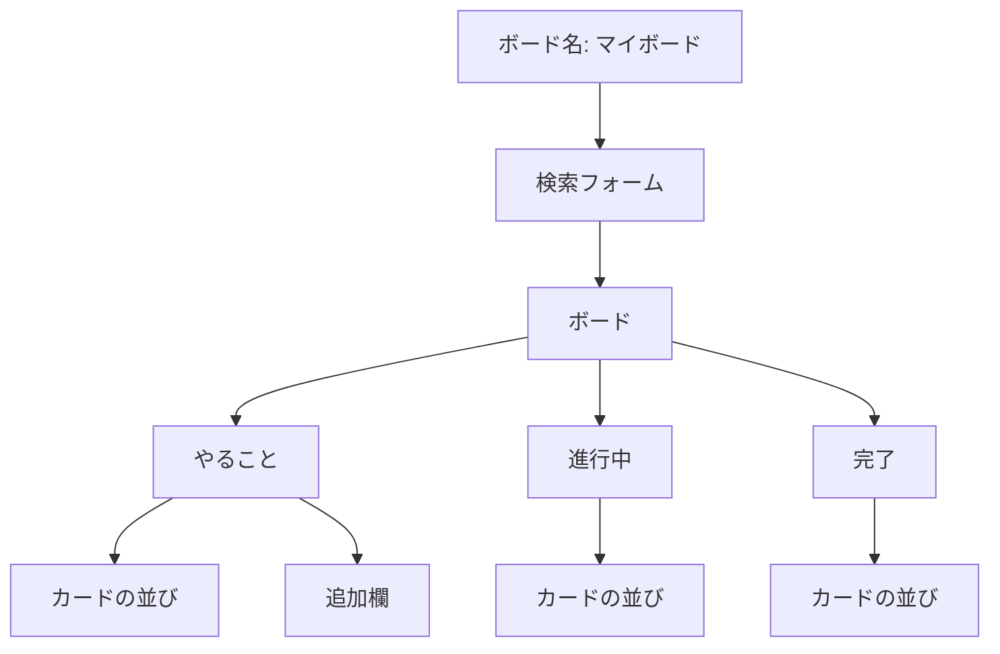
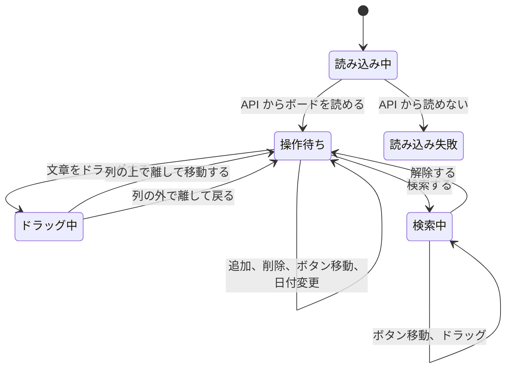

# 画面設計

機能の一覧は [functional-requirements.md](functional-requirements.md) に書く。この文書は、画面の構成、画面の流れ、見た目、入力チェック、ドラッグの手順を定める。

## 1. 画面一覧

ページは1つだけである。別のページへは遷移しない。

| ID | 画面名 | 役割 |
| --- | --- | --- |
| SCR-01 | タスクボード | ボード名、検索フォーム、3列、カード、追加欄を表示する |

## 2. 画面の構成

画面上部にボード名を置き、その下に検索フォームを置く。さらにその下に、3つの列を左から「やること」「進行中」「完了」の順で横に並べる。ウィンドウが狭いときは、横にスクロールして残りの列を見る。

| ID | 項目 | 場所 | 内容 |
| --- | --- | --- | --- |
| UI-01 | ボード名 | 画面上部 | 「マイボード」。利用者は変更できない |
| UI-02 | 列名 | 各列の上部 | 「やること」「進行中」「完了」。固定 |
| UI-03 | カード一覧 | 各列 | その列のカードを上から順に並べる。0件でも列は残す |
| UI-04 | カード文章 | 各カード | 1件のタスクの文章 |
| UI-04b | カードの日付 | 各カード | 日付があるときだけ、「2026年10月26日」の形で表示する |
| UI-04c | 日付の入力欄 | 各カード | 日付をあとから変える。検索中は変更できない |
| UI-05 | 削除 | 各カード | ラベルは「削除」。そのカードだけを消す。検索中は出さない |
| UI-06 | 移動 | 各カード | 「やることへ」「進行中へ」「完了へ」のうち、今いる列以外を表示する |
| UI-07 | 追加入力 | やることの最下部 | 案内文は「カードを追加」。検索中は出さない |
| UI-07b | 日付入力 | 追加入力の下 | 任意。空のまま追加できる |
| UI-08 | 追加ボタン | 日付入力の隣 | ラベルは「追加」 |
| UI-09 | ドラッグ中 | つかんでいるカード | 移動中だと分かる見た目にする |
| UI-10 | ドロップ先 | マウスが乗っている列 | 離したときに入る列だと分かる見た目にする |
| UI-11 | 検索フォーム | ボード名の下 | キーワード、状態、優先度、期限（から・まで）、「検索」ボタン。検索中だけ「解除」ボタンを出す |
| UI-12 | 検索の結果 | 検索フォームの下 | 検索中だけ、件数か「該当するタスクはありません」を出す |
| UI-13 | エラー | 検索フォームの下 | 読み込み、保存、検索に失敗したときに文言を出す |

| 状態 | 条件 | 画面 |
| --- | --- | --- |
| 読み込み中 | API からの応答を待っている | 「読み込み中」と表示する |
| 表示 | API からボードを読める | 保存された文章、日付、順番でカードを出す |
| 読み込み失敗 | API からボードを読めない | 「ボードを読み込めませんでした。サーバーとデータベースを確認してください。」と表示する。列は出すが、カードは出さない |
| 操作待ち | 表示のあと | 3列と、やることの追加欄を表示する |
| ドラッグ中 | カードの文章をドラッグしている | ドラッグ中のカードと、マウスが乗っている列を区別して見せる |
| 検索中 | 「検索」を押した | 条件に合うカードだけを3列に出す。追加欄と削除ボタンは出さない |
| 列が空 | その列のカードが0件 | 列名は残る。追加欄があるのはやることだけ |
| 幅が狭い | 3列が入りきらない | ボードを横にスクロールする |

## 3. 画面の流れ

別画面への遷移はない。同じタスクボードの中で、表示の状態とカードの位置が変わる。

| 起点 | 操作 | 着地 | 画面の変化 |
| --- | --- | --- | --- |
| 操作待ち | 追加が成功する | 操作待ち | やることの末尾にカードが増え、文章と日付の入力欄が空になる |
| 操作待ち | 削除を押す | 操作待ち | そのカードだけが消える。確認画面は出ない |
| 操作待ち | 移動ボタンを押す | 操作待ち | 行き先の列の末尾へ移り、その列へのボタンが隠れる |
| 操作待ち | カードの日付を変える | 操作待ち | カードに出る日付が変わる |
| 操作待ち | 文章をドラッグする | ドラッグ中 | ドラッグ中であることと、乗っている列が分かる |
| ドラッグ中 | 列の上で離す | 操作待ち | 離した位置へ入り、移動ボタンの表示が更新される |
| ドラッグ中 | 列の外で離す | 操作待ち | カードは元の位置のまま |
| 操作待ち | 検索する | 検索中 | 条件に合うカードだけになり、件数が出る |
| 検索中 | 解除を押す | 操作待ち | 検索前のボードに戻る |

## 4. 寸法と色

画面全体の背景は `#0079bf`、文字色は `#172b4d`、フォントは Segoe UI とする。

| 領域 | 決めごと |
| --- | --- |
| ヘッダー | 上下 16px、左右 20px。ボード名は 20px、太字、白色 |
| 検索フォーム | 内側は上下 12px、左右 16px。部品の間隔は 8px。折り返してよい |
| 検索の入力欄 | 内側は上下 6px、左右 8px。枠線は 1px `#ccc`。角は 4px |
| 検索ボタン | 内側は上下 6px、左右 12px。角は 4px。背景 `#0079bf`、文字は白 |
| 解除ボタン | 検索ボタンと同じ大きさ。背景 `#ddd` |
| エラー | 左右 20px、下 8px。文字は白 |
| ボード | 列を横並びにし、列の間隔は 12px。内側は上 8px、左右 16px、下 24px。入りきらないときは横スクロール |
| 列 | 幅 272px。内側 8px。角は 12px。背景は `#ebecf0`。幅を縮めない |
| 列名 | 14px。上 4px、左右 8px、下 8px |
| カード一覧 | カードの間隔は 8px |
| カード | 内側 8px。角は 8px。背景は白。文字は 14px、行間 1.4。影は `0 1px 1px rgba(9, 30, 66, 0.25)` |
| カードの日付 | 文章の下。12px。文字色 `#5e6c84`。日付がないカードには出さない |
| カードの日付の入力欄 | カードの幅いっぱい。12px。内側は上下 4px、左右 8px。角は 6px。背景 `#f4f5f7`。枠線は付けない |
| 削除ボタン | 12px。通常は枠なし、文字色 `#5e6c84`。指やカーソルが乗ったときは背景 `#ffebe6`、文字色 `#ae2e24` |
| 移動ボタン | 12px。背景 `#e4e6ea`。指やカーソルが乗ったときは背景 `#dfe1e6`。ボタンの間隔は 4px。折り返してよい |
| 追加欄 | 「やること」の最下部。入力欄との間隔は 8px。上に 8px 空ける |
| 追加入力 | 列の幅いっぱい。内側 8px。角は 8px。枠線は付けない |
| 日付入力 | 追加入力の下。余った幅を使う。内側 8px。角は 8px。枠線は付けない |
| 追加ボタン | 日付入力の隣。内側は上下 8px、左右 12px。角は 8px。背景 `#0079bf`、文字は白 |

状態ごとの見た目は、次のとおりである。

| 状態 | 見た目 |
| --- | --- |
| ドラッグ中のカード | 不透明度 0.45。カーソルはつかんでいる形 |
| ドロップ先の列 | 背景 `#dfe6ed`。内側に 2px の白枠 |
| 列が空 | 列の枠と列名は残す。カードがないことへの特別な文言は出さない |
| 幅が狭い | 列の幅は 272px のまま、ボードを横にスクロールする |

列のカード一覧の id は、やることを `todo-cards`、進行中を `doing-cards`、完了を `done-cards` とする。

## 5. 入力チェック

対象は、追加ボタンを押したときの文章である。最大文字数は設けない。エラーメッセージは出さない。

追加入力には `required` を付ける。未入力のときは、ブラウザが送信を止め、カードを追加しない。

送信されたときは、次の手順で扱う。

1. 前後の空白を除く。空白には、スペース、タブ、改行を含める。
2. 除いた結果が空のときは、カードを追加しない。入力欄の文章は残す。
3. 空でないときは、除いたあとの文章で「やること」の末尾にカードを追加する。日付入力に値があれば、その日付もカードに載せる。文章と日付の入力欄を空にし、文章の入力へフォーカスを戻す。
4. カードの文章は、HTML として解釈せず、文字列のまま表示する。日付は `YYYY-MM-DD` のときだけ、「2026年10月26日」の形で表示する。

## 6. ドラッグ

ドラッグは Pointer Events で行う。マウス、タッチ、ペンを同じ手順で扱う。削除ボタン、移動ボタン、日付の入力欄の上で押したときは、ドラッグを開始しない。カードには `touch-action: none` を付け、タッチでも指の移動をドラッグとして受け取る。

1. カードの文章側で押したとき、そのカードをドラッグ中にする。
2. 移動中は、ポインタの下にある列をドロップ先にする。列の外では、ドロップ先の表示を消す。ドラッグ中のカード自体は当たり判定から外す。
3. 列の上で離したとき、その列のカード一覧へ挿入する。各カードの上下の中央（上端に高さの半分を足した位置）よりポインタが上なら、そのカードの前に入れる。どのカードの中央よりも下なら、末尾に入れる。
4. 列の外で離したときと、ドラッグが中断されたときは、カードを元の位置に残す。離したあとは、ドラッグ中の表示とドロップ先の表示を消す。
5. 列の上で離して位置を移したあと、移動ボタンの表示を更新し、3列の文章、日付、順番を保存する。

ボタンによる移動は、行き先の列の末尾へ入れる。途中の位置には入れない。
