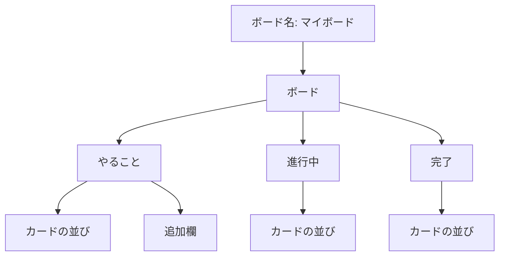
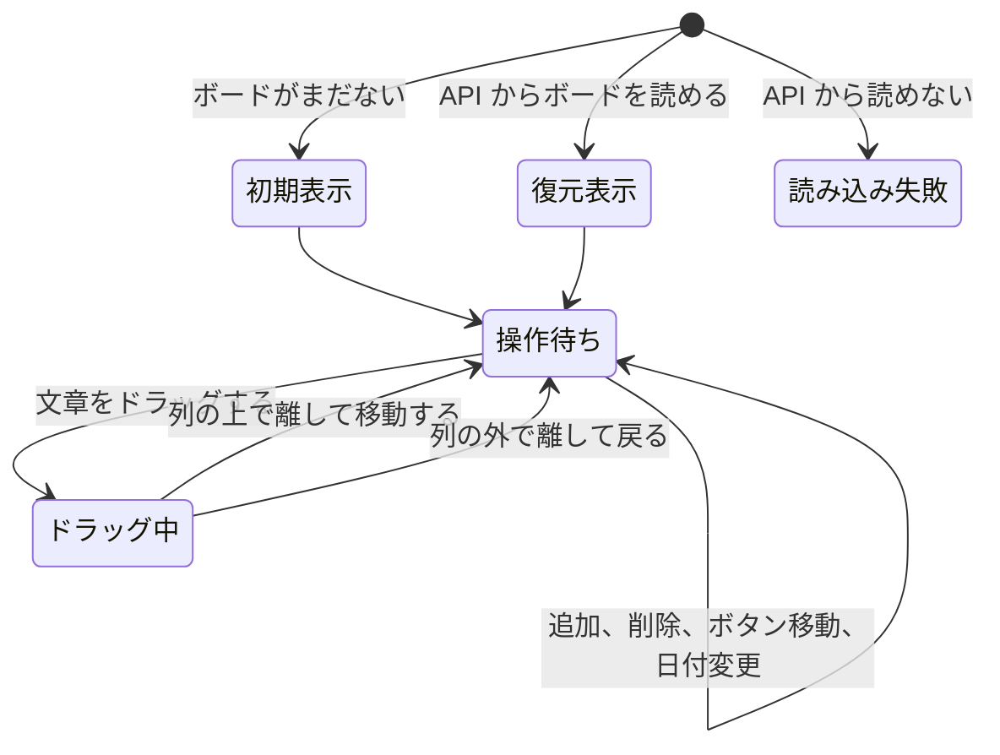
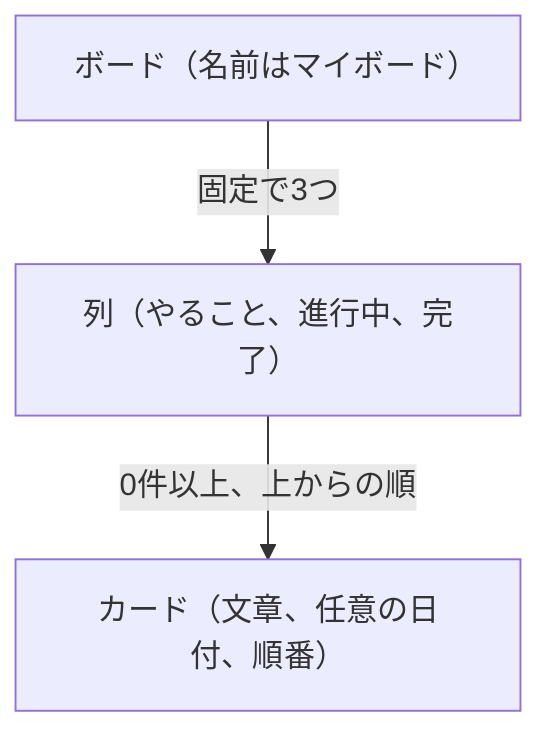
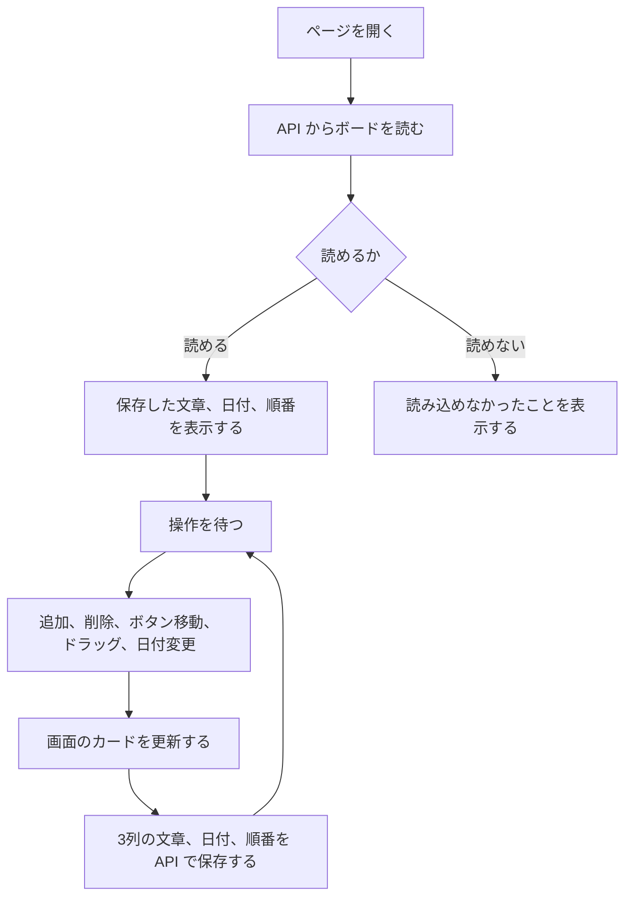

# タスクボード 要件定義

## 1. 概要

1人の利用者が、ブラウザ上でタスクをカードとして並べ、進捗に合わせて列を移す。Trelloのボードのうち、1枚のボードだけを対象にする。

## 2. 目的

やることを「やること」「進行中」「完了」に分け、今どの状態かを一目で分かるようにする。ページを閉じても、最後の並びが残る。

## 3. 利用者

PC、タブレット、スマートフォンのブラウザで、自分のタスクを管理する人。ログインはしない。

## 4. 前提

- 画面は React で作り、Spring Boot の API を通して PostgreSQL に保存する。
- ログインはしない。ボードは1つで、このサーバーを開くブラウザは同じボードを見る。
- 表示言語は日本語とする。

## 5. 用語

| 用語 | 意味 |
| --- | --- |
| ボード | 画面全体。名前は「マイボード」 |
| 列 | 進捗ごとのまとまり。やること、進行中、完了の3つ |
| カード | 1件のタスク。文章と、任意の日付を持つ |

## 6. 画面設計

ページは1つだけである。別のページへは遷移しない。

| ID | 画面名 | 役割 |
| --- | --- | --- |
| SCR-01 | タスクボード | ボード名、3列、カード、追加欄を表示する |

画面上部にボード名を置く。その下に3つの列を左から「やること」「進行中」「完了」の順で横に並べる。ウィンドウが狭いときは、横にスクロールして残りの列を見る。色、幅、余白、文字サイズは基本設計で定める。

| ID | 項目 | 場所 | 内容 |
| --- | --- | --- | --- |
| UI-01 | ボード名 | 画面上部 | 「マイボード」。利用者は変更できない |
| UI-02 | 列名 | 各列の上部 | 「やること」「進行中」「完了」。固定 |
| UI-03 | カード一覧 | 各列 | その列のカードを上から順に並べる。0件でも列は残す |
| UI-04 | カード文章 | 各カード | 1件のタスクの文章 |
| UI-04b | カードの日付 | 各カード | 追加時に日付があるときだけ、「2026年10月26日」の形で表示する |
| UI-05 | 削除 | 各カード | ラベルは「削除」。そのカードだけを消す |
| UI-06 | 移動 | 各カード | 「やることへ」「進行中へ」「完了へ」のうち、今いる列以外を表示する |
| UI-07 | 追加入力 | やることの最下部 | 案内文は「カードを追加」 |
| UI-07b | 日付入力 | 追加入力の下 | 任意。空のまま追加できる |
| UI-08 | 追加ボタン | 日付入力の隣 | ラベルは「追加」 |
| UI-09 | ドラッグ中 | つかんでいるカード | 移動中だと分かる見た目にする。見た目の指定は基本設計 |
| UI-10 | ドロップ先 | マウスが乗っている列 | 離したときに入る列だと分かる見た目にする。見た目の指定は基本設計 |

| 状態 | 条件 | 画面 |
| --- | --- | --- |
| 初期表示 | `tasks` が空 | 起動時に F-01 の初期カードを保存して出す。各カードに削除と移動を付ける |
| 復元表示 | API からボードを読める | 保存された文章、日付、順番でカードを出す |
| 読み込み失敗 | API からボードを読めない | 読み込めなかったことを表示する。カードは出さない |
| 操作待ち | 初期表示または復元表示のあと | 3列と、やることの追加欄を表示する |
| ドラッグ中 | カードの文章をドラッグしている | ドラッグ中のカードと、マウスが乗っている列を区別して見せる |
| 列が空 | その列のカードが0件 | 列名は残る。追加欄があるのはやることだけ |
| 幅が狭い | 3列が入りきらない | ボードを横にスクロールする |

## 7. 画面の流れ

別画面への遷移はない。同じタスクボードの中で、表示の状態とカードの位置が変わる。

| 起点 | 操作 | 着地 | 画面の変化 |
| --- | --- | --- | --- |
| 操作待ち | 追加が成功する | 操作待ち | やることの末尾にカードが増え、文章と日付の入力欄が空になる |
| 操作待ち | 削除を押す | 操作待ち | そのカードだけが消える。確認画面は出ない |
| 操作待ち | 移動ボタンを押す | 操作待ち | 行き先の列の末尾へ移り、その列へのボタンが隠れる |
| 操作待ち | 文章をドラッグする | ドラッグ中 | ドラッグ中であることと、乗っている列が分かる |
| ドラッグ中 | 列の上で離す | 操作待ち | 離した位置へ入り、移動ボタンの表示が更新される |
| ドラッグ中 | 列の外で離す | 操作待ち | カードは元の位置のまま |

追加、削除、ボタン移動、ドラッグで位置が変わった直後、およびカードの日付を変えた直後に、3列の文章、日付、順番を保存する。削除ボタンと移動ボタンの上では、ドラッグを開始しない。ボタン移動は行き先の末尾だけで、途中には挿入しない。ドラッグは同じ列の中の並び替えにも使う。離した位置がカードの中央より上ならその前、どのカードよりも下なら末尾に入る。

## 8. 機能要件

| ID | 要件 |
| --- | --- |
| F-01 | `tasks` が空のとき、次のカードを出す。やること: 「買い物リストを作る」「メールを返す」。進行中: 「企画書の下書き」「資料を読み直す」。完了: 「会議室を予約する」「日程を共有する」 |
| F-02 | 「やること」の入力欄に文章を入れて「追加」を押すと、その列の末尾にカードが増える。日付を入れたときだけ、その日付もカードに出す。日付は空でも追加できる |
| F-03 | 文章の前後の空白は除く。空白だけの入力ではカードを追加しない |
| F-04 | 追加に成功したら、文章と日付の入力欄を空にして、そのまま続きを入力できる状態にする |
| F-05 | どの列のカードでも「削除」を押すと、そのカードだけが消える。確認画面は出さない |
| F-06 | 各カードに、今いる列以外への移動ボタンを出す。ボタン名は「やることへ」「進行中へ」「完了へ」 |
| F-07 | 移動ボタンを押すと、そのカードは行き先の列の末尾へ移る。移ったあとは、その列用のボタンを隠す |
| F-08 | カードの文章をドラッグして列の上で離すと、その列へ移る。離した位置がカードの中央より上ならその前、どのカードよりも下なら末尾に入る |
| F-09 | 削除ボタンと移動ボタンの上では、ドラッグを開始しない |
| F-10 | 追加、削除、ボタン移動、ドラッグ移動、カードの日付変更の直後に、3列のカード文章、日付、順番を API で保存する |
| F-11 | ページを開き直したとき、`tasks` の並びでカードを復元する。`tasks` が空のときは、F-01の初期カードを保存して出す。API から読めないときは、読み込めなかったことを表示する |

## 9. データ構造とデータの流れ

カードが画面に出すのは文章、任意の日付、列の中の順番である。データベースの `tasks` は、それに加えて説明、優先度、作成日時、更新日時を持つ。テーブル定義と ER図は `docs/database-design.md` に書く。

保存先は PostgreSQL の `tasks` である。状態は `todo`、`in_progress`、`done`。日付の通知や繰り返し、担当者、ラベルは持たせない。ログインしないため、このサーバーを開いたブラウザは同じタスク一覧を共有する。

画面を開いたときは `GET /api/tasks` でカードを読む。追加、削除、ボタン移動、ドラッグ、カードの日付変更の直後に、3列の内容を `PUT /api/tasks` で書き換える。1件は `GET /api/tasks/{id}`、列だけは `GET /api/tasks/status/{status}` で読む。条件に合うタスクは `GET /api/tasks/search` で探す。条件はキーワード、状態、優先度、期限の範囲で、どれも省略できる。

ページを開いたときは、データベースから画面へ向かう。操作したときは、画面を先に更新し、その結果を API へ書く。サーバーを起動したとき `tasks` が空なら、`data.sql` が初期カードを入れる。利用者がカードをすべて消したあとは、空のボードのまま残る。ただし、空のままサーバーを起動し直すと、初期カードが再び入る。

## 10. 非機能要件

### 対応環境

- 利用する端末は、PC、タブレット、スマートフォンとする。
- どの端末でも、ブラウザ上でカードの表示、追加、削除、ボタンによる移動、ドラッグによる移動と並び替えができる。
- 3列が画面に入りきらないときは、横スクロールで残りの列を見る。
- 保存はサーバーの PostgreSQL に残る。このサーバーを開く端末のあいだで、同じボードを見る。

### 性能

- 追加、削除、ボタン移動、ドラッグ移動の結果は、ページを再読み込みせず、操作から1秒以内に画面へ反映する。

### 信頼性

- 追加、削除、移動、ドラッグ、日付変更の直後に保存する。ページを閉じても、PostgreSQL にその並びが残る。
- ボードがまだないときは、初期カードを保存して表示する。API から読めないときは、読み込めなかったことを表示する。壊れたデータを直す機能は持たない。
- データベースのカードを消したときは、画面からも消え、戻す手段はない。
- 複数のタブで同時に編集したときは、最後に保存した内容が次に開いたときに残る。開いている別のタブへは自動では反映しない。

### セキュリティ

- カードの文章と日付は、入力された文字として表示する。HTMLとして解釈しない。
- カードの文章と日付は API を通して PostgreSQL に保存する。ログインはない。

### 使用性

- 表示言語は日本語とする。
- 追加、削除、ボタンによる移動は、PC、タブレット、スマートフォンで操作できる。
- 列の間の移動と、同じ列の中の並び替えは、ドラッグで行う。

### 保守性

- バックエンドは Java と Spring Boot、フロントエンドは React、データベースは PostgreSQL で構成する。
- 画面は React、API は Spring Boot、保存は PostgreSQL が担当する。

## 11. 技術選定

画面の操作と、ページを閉じても並びが残ることは、ここまでの要件のとおりとする。実装は、バックエンドを Java と Spring Boot、フロントエンドを React、データベースを PostgreSQL で行う。

| 項目 | 採用 | 条件との対応 |
| --- | --- | --- |
| バックエンド | Java 21、Spring Boot、Gradle | タスクの読み書きを API で行う |
| フロントエンド | React | 追加、削除、移動、日付変更を1つの画面で処理する |
| データベース | PostgreSQL | ページを閉じても、カードの文章、日付、順番が残る |
| 画面と API のつなぎ | `GET /api/tasks`、`PUT /api/tasks` | 開いたときに読み、操作の直後に3列を書き換える |
| 読み取り | `GET /api/tasks/{id}`、`GET /api/tasks/status/{status}`、`GET /api/tasks/search` | 1件と、状態ごとの列と、条件に合うタスクを返す |
| ドラッグ | Pointer Events | マウスでもタッチでも、カードをつかんで移動できる |
| 文字の表示 | 文字列として画面に出す | HTMLとして解釈しない |
| 文字コード | UTF-8 | 日本語をそのまま保存し、表示できる |
| 開発時の起動 | Spring Boot と Vite | API は 8080、画面は 5173。画面からの `/api` は API へ転送する |

ログインはしない。このサーバーを開くブラウザは同じボードを共有する。複数タブの同時編集では、最後に保存した内容が次に開いたときに残る。開いている別のタブへは自動では反映しない。

API の JSON、テーブル、読めないときの表示、ドラッグ位置の算出、色、幅、余白は基本設計と `docs/database-design.md` で定める。

## 12. 対象外

この版では、次はやらない。

- カードの文章をあとから編集すること（日付はあとから変えられる）
- 列の追加、名前の変更、削除
- ボードを複数作ること
- 利用者登録、ログイン、他の人との共有
- 日付の通知、繰り返し、チェックリスト、添付ファイル
